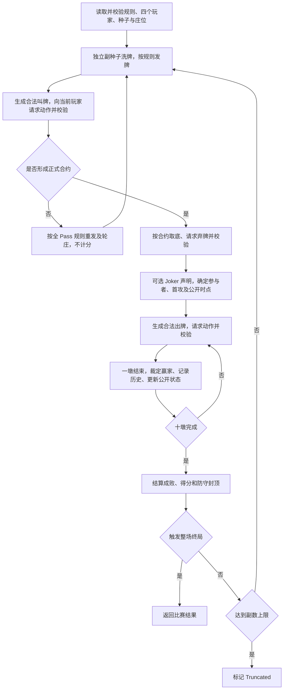
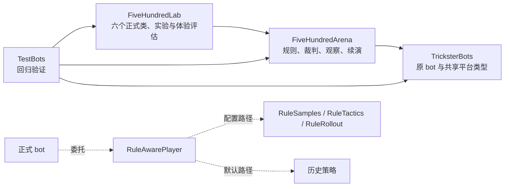

# Five Hundred 开发过程与成果总结

本文总结截至 2026-11-05 的实现。它面向后续维护、接入与策略开发，描述当前源码的实际行为；早期实验报告、配置元数据中的阶段标记和历史测试数量，应按各自产生时的版本理解。

## 1. 开发目标与当前交付

项目从原仓库的 `FiveHundredBot.cs` 出发，逐步建立了可以复现、比较和分析 bot 行为的四人对战系统。最终使用场景包括自动策略实验，以及一名人类与三个 bot 对局，尤其重视人类对其 bot 搭档的信任与配合体验。

目前交付包括：

- 四人、固定对家组队的对战引擎，负责发牌、合法动作、信息公开、计分、终局和牌谱。
- 完整展开的规则预设、自定义模板、结构 Schema、约束资料和运行时加载器。
- Random、Weak、Medium、Fast、Strong、Partner 六种正式 bot 入口，均保留规则接口。
- 成对对战、混合搭档测试、耗时记录、牌谱重放、搭档体验场景及回归测试。
- 历史策略、模型、报告和 Adapt 实验归档；Adapt 暂停推进，预训练方案暂不作为正式方案。

当前没有新增人类对局界面，也没有把六个新入口接入旧 WebAPI 路由。它们是可供对战程序及后续交互层调用的玩家对象。

## 2. 开发过程

| 阶段 | 主要工作 | 留下的成果与判断 |
|---|---|---|
| 建立裁判与评估基础 | 明确默认规则、隔离玩家观察、验证动作、记录对局 | `FiveHundredArena`，可复现的完整比赛与重放 |
| 建立强弱梯度 | 保留原策略作为 Medium，增加 Random、Weak、Strong | 随机合法基线、简单启发式、隐藏牌采样与续演搜索 |
| 优化计算成本 | 研究重复计算、候选裁剪、续演成本，逐版验证 | Fast 成为速度优先方案；保留旧版本供对照 |
| 引入体验指标 | 检查盲目竞叫、保护搭档、信号回应与零墩攻防 | 固定可达场景、分级检查、Partner 策略 |
| 规则配置化 | 收集澳式、美式、加拿大式等规则，形成完整配置，再接入裁判及 bot | 规则预设、混搭模板、约束校验、规则感知决策 |
| 自适应实验 | 根据公开行为调整续演叫牌风格、隐藏牌权重和出牌策略，并加强学习 | Adapt 三阶段机制及后续版本；收益不理想，现已搁置 |
| 收尾整理 | 去除重复计算、集中正式入口、归档实验、规范命名与注释 | 行为快照、源码指纹、维护记录 |

早期 Strong 相对 Medium 的收益曾不足以抵偿增加的计算量，因此后续优化优先寻找低成本判断和减少无效搜索。Fast 的目标是以低计算量取得接近 Strong 的表现；Partner 进一步优先改善明显影响人类体验的行为。它们的命名代表设计定位，不能视作跨规则、跨对手都成立的严格强度排序。

历史实测见 [原始基准](FiveHundredArena/BENCHMARKS.md)、[归档报告](FiveHundredLab/Archive/Reports/)、[体验评估](FiveHundredLab/Usability/ASSESSMENT.md)。这些数据有各自的规则、种子、预算和样本限制，不合并成当前统一胜率。

## 3. 规则配置在实际游戏中的表现

### 3.1 默认规则与显式配置是两条路径

`RuleConfiguration.Load(null)` 返回原来的 `Rules`。`new Engine()`、省略 bot 的规则参数等用法继续采用原默认规则及历史策略。

读取带 `schemaVersion` 的完整 JSON 时，加载器生成 `ConfiguredRules`，执行结构与语义、能力校验。引擎与规则版 bot 从该规则上下文决策。旧扁平 `Rules` JSON 仍有兼容入口。

**显式加载 `legacy-au-4p-v1.json` 与省略配置，在规则意图上兼容，但 bot 实现路径不同。** 前者采用规则版算法，后者委托历史策略，不能假定双方逐动作一致。历史 Medium 本身是原 `FiveHundredBot` 的改名继承；规则版 Medium 则是针对配置实现的启发式策略。

推荐一次加载规则，并将同一配置交给引擎与所有玩家。bot 会检查绑定规则与观察中的规则是否匹配，不会遇到冲突后自行挑一份执行。

### 3.2 已交付配置

配置目录为 [FiveHundredRules](FiveHundredRules/README.md)。所有预设、模板和示例都保存完整规则，没有运行时继承或自动合并；`metadata.basedOn` 仅记录来源。

| 配置 | 对局中的主要效果 |
|---|---|
| [原默认](FiveHundredRules/presets/legacy-au-4p-v1.json) | 43 张牌、3 张底牌、多轮竞叫、六阶起叫；Misère/Open Misère 有历史叫牌门槛；终局阈值 ±500 |
| [澳式参考](FiveHundredRules/presets/au-reference-4p-v1.json) | 保留 43/3 和多轮；调整 Open Misère 的竞叫位置及门槛，加入未命名 Joker 的领门限制和零墩缺门强制 Joker 等规则 |
| [美式单轮参考](FiveHundredRules/presets/us-single-round-4p-v1.json) | 每人一次叫牌机会，可作六阶 Inkle 信息叫；正式普通合约七阶起；Open Misère 关闭，允许防守达标直接获胜 |
| [加拿大平台参考](FiveHundredRules/presets/canadian-platform-reference-4p-v1.json) | 46 张牌、双 Joker、6 张底牌；单轮、无 Inkle、七阶起叫；Misère 关闭，终局阈值 ±1000 |
| [自定义模板](FiveHundredRules/custom/custom-4p.template.json) | 初值与旧默认一致，可逐项编辑后另存新 ID |
| [混搭示例](FiveHundredRules/examples/mixed-single-round-au-joker-v1.json) | 单轮竞叫结合澳式 Joker 限制，以及防守得分 490 封顶 |

“美式”“加拿大平台参考”不是统一官方赛规的保证。上传规则资料未明确的边界，在配置元数据中注明为项目选择；加拿大参考也不等于完整复刻某个平台。原始资料保存在 [sources](FiveHundredRules/sources/)。

### 3.3 配置如何改变裁判及策略

| 规则组 | 引擎执行 | bot 对应行为 |
|---|---|---|
| 牌组、底牌与发牌 | 按实际牌清单、底牌数量、逐张或分包方式发牌 | 用实际牌组采样；弃牌数量从接口传入，可从 16 张中弃 6 张，或不取底弃 0 张 |
| 竞叫 | 使用配置排序、位置起叫门槛、特殊资格、单/多轮与 Pass 规则生成合法动作 | 只从合法集合选；把 Inkle 当作信息动作，计分启发式使用当前规则 |
| 合约流程 | 按合约决定取底、参与者、首攻、公开手牌时点 | 续演同步处理停打玩家、首攻和明牌时机 |
| 有效花色、Bower 与 Joker | 跟有效花色；按配置裁定将吃、超吃、Joker 资格、命名花色和高低 | 不把左 Bower 当原花色；评估低 Joker 与高 Joker 的不同风险，识别公开命名 |
| 计分与终局 | 普通表、零墩分、破约双方收益、Slam、防守封顶、获胜条件 | 收益估计及续演调用相应结算，并计入本副是否导致整场胜负 |

竞叫顺序与分值表独立：把某合约改成 300 分，不会自动改变其压叫位置。防守墩分与破约所得若同时启用，按配置相加；防守封顶限制本副新增收入，不把已有高分倒扣。Slam 仅用于普通合约，不套用到 Misère。

Joker 的“可跟出”“缺门强制出”“可领哪门”“高低”“预命名”分别约束。已命名 Joker 按其指定花色跟牌和争墩，不能继续当作跨门万能大牌。除 Random 外，当前规则版 bot 主动放弃可选预命名，但能处理别人的合法命名；这个决策阶段尚未专门优化。

### 3.4 自定义的边界

六份交付配置都能导入运行，但 Schema 可表达的范围大于已实现的范围。加载器会拒绝尚未支持的高级流程，包括 Double/Grand Nullo、team_zero、庄家控制两手、私看搭档牌、自加叫、改变定约后重开叫牌、强制庄家叫牌、无定约 NT、Ace–no-face 重发申请、固定副数赛事及提前结束等。完整列表见 [ENGINE_SUPPORT.md](FiveHundredRules/ENGINE_SUPPORT.md)。

自定义时至少满足以下关系：牌数等于 40 加底牌数；Joker 排序覆盖实际 Joker；竞叫排序恰好覆盖启用合约；资格门槛可达；单轮与重入模式兼容；参与者和公开范围一致；计分及终局模式在引擎支持范围内。

结构检查见 `rules.schema.json` / `ConfigurationStructure.cs`，运行时语义及能力检查见 `ConfiguredRules.Validate`。`constraints.json` 和 `acceptance-cases.json` 是规则约束与验收资料，不能理解为引擎动态解释这些文件来自动获得新能力。

某些自定义 Joker 领门限制可能在特定牌局导致无合法动作。静态检查并未证明所有组合无死局；运行时会明确失败并保留部分牌谱，不自动放宽规则。新增混搭仍需专门的规则测试与对局验证。

## 4. 对战引擎流程

主实现为 [Engine.cs](FiveHundredArena/Engine.cs)，数据与接口在 [Model.cs](FiveHundredArena/Model.cs)，裁判规则在 [Rules.cs](FiveHundredArena/Rules.cs) 和 [ConfiguredRules.cs](FiveHundredArena/ConfiguredRules.cs)。



### 4.1 玩家交互与信息边界

每个座位是一个独立 `IPlayer`，实现 `Bid`、`Discard`、`Play`；可选的 `IJokerDeclarationPlayer` 提供 Joker 预命名。人类交互层也可以实现相同接口，不过当前仓库尚未提供完整的人机交互产品。

玩家收到 `Observation`：自己的牌、自己的弃牌、公开竞叫与出牌、双方分数、剩余张数、合约及按规则公开的手牌。拿底者能从自己的扩充手牌看到底牌，其他人不能看到底牌或暗弃。Open Misère 只在规定时点公开。

引擎先保留合法动作及真实状态，再把观察和动作列表交给玩家；玩家返回后独立校验。非法动作或策略异常会终止该实验并记录失败，不代替玩家挑选动作。观察中的列表使用副本；这不是针对恶意同进程插件的安全沙箱，也没有硬性计算超时。

### 4.2 复现、统计与重放

每副洗牌种子由比赛种子与副序号推导，不随前一副玩家的计算或动作数量漂移；bot 的随机流与发牌随机流分离。成对实验交换队伍座位并共用种子与庄位，降低牌运和座位偏差。两种策略导致比赛长度不同，仍不能保证后续竞叫、底牌和公开信息相同。

`games.jsonl` 保存完整比赛、规则快照、牌、动作、每墩赢家和得分。`summary.json` 保存胜负、截断、合约表现、耗时、版本和程序集指纹等；混合实验另记录相应实验信息。完整日志有隐藏牌，只供裁判和赛后审计使用。

重放通过 `ReplayPlayer` 重交记录动作，让裁判重新验证和结算；它验证日志一致性，不是独立于裁判的规则正确性证明。完整规则文档随日志保存，之后修改预设文件不会改变既有重放的规则。

达到运行上限仍未结束的比赛标记为 `Truncated`，不把当前领先者当赢家。胜率、体验通过率和耗时必须分别报告；小样本只适合迭代反馈。

## 5. 六种正式 bot

正式入口位于 [FiveHundredLab/Bots/FiveHundred](FiveHundredLab/Bots/FiveHundred/README.md)，命名空间为 `FiveHundredLab.Bots.FiveHundred`。六类继承 `FiveHundredRuleBot`，接受 `(int seed = 1, Rules? rules = null)`，并提供 `FromConfiguration`。共享规则算法在 Arena 中实现。

### 5.1 显式配置下的策略

| bot | 叫牌 | 弃牌 | 出牌与搜索 |
|---|---|---|---|
| Random | 从包含 Pass 的合法叫牌中随机选择 | 随机抽取所需张数 | 从合法动作随机选择；可随机预命名 Joker |
| Weak | 简单牌力、较保守门槛，不主动叫零墩 | 基础逐牌排序 | 即时局部判断，不续演 |
| Medium | 牌力、搭档叫牌支持、成败收益及终局效用估计 | 枚举后按保留牌型评分选最佳 | 有效花色、赢墩/避墩等确定性战术，不续演 |
| Fast | 使用规则版启发式叫牌 | 评分筛出最多 4 组，每组共用 4 个隐藏牌样本续演 | 基准战术优先，最多 4 个动作候选、4 个样本 |
| Strong | 使用规则版启发式叫牌 | 最多 12 组、8 个样本 | 评估全部合法出牌候选、8 个样本 |
| Partner | 基于 Fast 的叫牌 | Fast 预算后修补牌型结构 | 先执行公开信息可确认的体验保护，再进行 Fast 预算搜索 |

这些样本数是每个候选共用的隐藏世界数，不等于总续演数。只有一个候选时无需比较搜索；`LastRollouts` 是最近一次决策的实际续演次数。

非随机规则版的叫牌用预估成功率结合真实计分计算收益；Inkle 不作为最终合约，必要时根据花色长度选择信息叫。**规则版 Strong 尚未移植原 Strong 的完整竞叫续演**，不能将它描述为所有阶段都使用原搜索策略。

### 5.2 默认路径保留的历史策略

| 正式入口 | 不使用新格式配置时委托的实现 | 特点 |
|---|---|---|
| RandomBot | `RandomLegalBot` | 保留历史合法随机策略 |
| WeakBot | `FiveHundredArena.WeakBot` | 简单叫牌、弃牌与即时抢墩 |
| MediumBot | `MediumBotPlayer` → `Trickster.Bots.MediumBot` → `FiveHundredBot` | 原 bot 策略不变 |
| FastBot | `VisibilityFastV8` | 复用轻量基准、代表动作裁剪；末位、早中晚局使用不同小样本预算 |
| StrongBot | `FiveHundredArena.StrongBot` | 以 Medium 为基准，对叫牌、弃牌和出牌做隐藏牌采样续演；证据不足时保留基准 |
| PartnerBot | `PartnerFastV9` | Fast 加公开必破、保护搭档赢家、约定信号、弃牌结构与稳定排序 |

历史 Fast 并非始终固定四样本；它的末位出牌通常用两样本，较早阶段四样本，较晚阶段八样本。不要把规则版的固定预算表套用到默认路径。历史 Strong 的续演以 Medium 为其他玩家的模型，而 Adapt 曾尝试改变这一假设。

### 5.3 续演如何工作

规则版的 `RuleSamples` 仅从观察构造可能牌局：扣除已知牌，按各玩家剩余张数分配未知牌，并满足公开缺门、亮牌与 Joker 已知持有者约束。未知底牌或弃牌保留对应槽位；不会读取裁判实际手牌或发牌种子。

`RuleRollout` 对每个候选执行完整的剩余出牌，其他行动使用 `RuleTactics` 的规则感知战术，而非递归调用 Strong。每个假设世界维护独立规则上下文；模拟中的玩家按各自假设手牌及当时公开信息行动。

候选共用同一批世界，减少比较噪声。结算使用规则分数与防守封顶；若本副触发整场终局，效用为正负 `4 × WinScore`，否则使用本队与对手得分增量之差。它是搜索用的近似效用，不是校准后的整场胜率。

规则版采样是满足公开约束的近似分配，不保证均匀条件分布或精确后验，也没有搬入历史采样器的叫牌软权重。因此，导入成功、行动合法不等于变体下的强度已经系统验证。

### 5.4 Partner 与体验测试

Partner 优先处理人类容易感到明显不合理的行为：自己的 Misère 避免可确认会吃墩的首引；对手零墩有公开必破机会时积极兑现；保护搭档已稳拿的墩及后续控制；在适用条件下回应低牌垫牌请求，利用公开缺门，并修补危险弃牌结构。

低牌请求是一项明确约定，不是所有地方都使用的牌规；可由规则证明的必然结果，与依赖搭档约定的建议分开评估。

[体验测试](FiveHundredLab/Usability/README.md) 有 17 个可由正式引擎到达的局面、18 条 Critical / Advisory / Control 检查，含被迫吃墩等反例。通过率表示这些固定局面上的稳定性，不等于实战低级失误率、真人满意度或胜率。Partner 的目标是改善配合体验，不是取代 Strong 成为绝对最强策略。

## 6. 源码依赖关系

### 6.1 项目引用与运行调用

下图实线表示项目引用，虚线表示主要运行调用。原项目还包含其他纸牌游戏，此处只列出 Five Hundred 相关部分。



原 `TricksterBots` 项目目标框架为 .NET Standard 2.0；Arena 与 Lab 是 .NET 8 可执行项目，也可被测试项目引用。正式类放在 Lab，以容纳 Legacy 依赖并保持 `Lab → Arena → TricksterBots` 的方向。若直接移回原项目，需要先处理框架和反向依赖，不能只搬文件。

### 6.2 关键文件导航

| 模块 | 源码 | 依赖与职责 |
|---|---|---|
| 原始策略 | [FiveHundredBot.cs](TricksterBots/Bots/FiveHundred/FiveHundredBot.cs)、[MediumBot.cs](TricksterBots/Bots/FiveHundred/MediumBot.cs) | 原平台建议接口；历史 Medium 保持继承关系 |
| 观察与牌谱 | [Model.cs](FiveHundredArena/Model.cs) | `IPlayer`、Observation、动作、合约、记录等基础类型 |
| 默认裁判 | [Rules.cs](FiveHundredArena/Rules.cs) | 默认牌组、合法叫牌/出牌、有效花色、赢墩、计分和终局 |
| 配置裁判 | [ConfiguredRules.cs](FiveHundredArena/ConfiguredRules.cs)、[ConfigurationStructure.cs](FiveHundredArena/ConfigurationStructure.cs) | 文件加载、Schema 结构检查、语义及能力检查、配置规则执行 |
| 对局调度 | [Engine.cs](FiveHundredArena/Engine.cs) | 调用规则生成合法动作，调用玩家决策，校验并推进对局 |
| 历史 bot 适配 | [ExistingBotPlayer.cs](FiveHundredArena/ExistingBotPlayer.cs)、[SimpleBots.cs](FiveHundredArena/SimpleBots.cs) | 将观察转换为原平台输入，或提供基础策略 |
| 历史搜索 | [StrongBot.cs](FiveHundredArena/StrongBot.cs)、[BeliefSampler.cs](FiveHundredArena/BeliefSampler.cs)、[ForwardModel.cs](FiveHundredArena/ForwardModel.cs) | 默认 Strong 的候选、采样、Medium 续演 |
| 公共牌力工具 | [HandEvaluator.cs](FiveHundredArena/HandEvaluator.cs) | 牌力、弃牌组合与保留牌型评分，被规则版和搜索策略使用 |
| 规则策略核心 | [RuleAwarePlayer.cs](FiveHundredArena/Bots/FiveHundred/RuleAwarePlayer.cs) | 规则匹配、等级分流、竞叫估值、候选筛选、搜索比较、声明接口 |
| 规则续演与战术 | [RuleSimulation.cs](FiveHundredArena/Bots/FiveHundred/RuleSimulation.cs) | `RuleSamples`、`RuleTactics`、`RuleRollout`；复用裁判的合法动作和计分语义 |
| 六个正式入口 | [FiveHundredRuleBot.cs](FiveHundredLab/Bots/FiveHundred/FiveHundredRuleBot.cs) 及同目录六类 | 组合共享核心，提供规则参数、配置加载入口及标准玩家接口 |
| 默认 Fast / Partner | [Legacy](FiveHundredLab/Bots/FiveHundred/Legacy/) | `VisibilityFastV8`、`PartnerFastV9` 及其基准、裁剪、续演、特征工具 |
| 策略注册 | [Profiles.cs](FiveHundredLab/Profiles.cs) | `Create` 保留历史 profile；`CreateForRules` 返回正式规则类并保留别名 |
| 实验入口 | [Arena Program](FiveHundredArena/Program.cs)、[Lab Program](FiveHundredLab/Program.cs)、[Experiments.cs](FiveHundredLab/Experiments.cs) | 命令行、成对或混合对局、统计与输出 |
| 体验评估 | [Usability](FiveHundredLab/Usability/) | 可达场景、行为检查、原始动作与评估报告 |
| 停用实验 | [Lab Archive](FiveHundredLab/Archive/README.md)、[Arena Adapt](FiveHundredArena/Archive/Adapt/) | 历史策略、模型、报告及自适应机制 |

`Legacy` 仍是正式默认路径的有效依赖，不能当作过时代码直接删除。Archive 中部分源码也仍参与编译，以兼容历史 profile、公共辅助类型和回归测试；归档不等于已从程序集剔除。迁移位置见 [cleanup-relocations.json](FiveHundredRules/cleanup-relocations.json)。

## 7. 验证、效率优化与后续维护

最后一轮收尾的全量验证为 **510 项测试通过**、**61 项冻结源码/模型校验通过**。这是当次运行结果，不是本文新增运行的测试数量。

| 验证层 | 主要文件 | 能说明什么 |
|---|---|---|
| 裁判与基础策略 | `TestFiveHundredArena`、`TestFiveHundredDifficulties`、`TestFiveHundredBot` | 默认规则、完整比赛、合法性、隐藏信息、重放和历史继承 |
| 规则配置 | [TestRuleConfiguration.cs](TestBots/TestRuleConfiguration.cs) | 六份配置、结构与冲突拒绝、单轮、双 Joker、计分、序列化和重放 |
| bot 配置 | [TestRuleAwareBots.cs](TestBots/TestRuleAwareBots.cs) | 六 bot × 六配置、默认委托、行为响应、预算和规则不匹配拒绝 |
| 体验场景 | [TestFiveHundredUsability.cs](TestBots/TestFiveHundredUsability.cs) | 场景可达、检查正反例、信息边界和报告可靠性 |
| 优化行为回归 | [TestCleanup.cs](TestBots/TestCleanup.cs)、[决策快照](TestBots/RuleBotDecisionSnapshots.json) | 对照优化前 36 份行为指纹，检查叫牌返回及固定上下文整副出牌 |
| 历史版本校验 | `frozen-baselines-v1.json`、`frozen-profiles-*.json` | 已冻结文件内容未意外变化；不证明策略正确或更强 |

36 份行为快照覆盖六种策略与六份配置：先验证 bot 自身叫牌返回，再固定合法竞叫上下文确保弃牌和整副出牌被测。它们不是 36 场自然竞叫下完整打到分数终局的比赛，也不能穷举所有可能局面。

收尾优化缓存了重复的基础牌力、同次弃牌决策的危险度、同次隐藏牌匹配的有效花色。没有改变候选顺序、随机数调用顺序、算术结合顺序或搜索预算；上述快照保持一致。减少重复工作可以确认，具体耗时收益仍需独立计时，未据此宣称统一加速比例。详情见 [MAINTENANCE.md](FiveHundredLab/MAINTENANCE.md)。

后续增加规则时，应先确认配置字段与跨字段约束，再同时覆盖裁判、观察、续演及重放；不要只让 JSON 能加载。增加策略或调参应使用新名称，保留可复现基线。变体强度与人类体验应分别测试，不将配置导入通过当作强度无下降的证明。

## 8. 接入与常用命令

从仓库根目录构建，使用 .NET 8。下例在四个座位共享规则；0/2 同队，1/3 同队。

```csharp
using FiveHundredArena;
using FiveHundredLab.Bots.FiveHundred;

var rules = RuleConfiguration.Load("FiveHundredRules/presets/au-reference-4p-v1.json");
IPlayer[] players =
[
    new PartnerBot(seed: 11, rules: rules),
    new MediumBot(seed: 12, rules: rules),
    new FastBot(seed: 13, rules: rules),
    new StrongBot(seed: 14, rules: rules)
];
var game = new Engine(rules).Run(players, seed: 2026);
```

```sh
dotnet build TricksterBots.sln -c Release
dotnet test TestBots -c Release --no-build
dotnet run --project FiveHundredLab -c Release -- verify-frozen --root .
dotnet run --project FiveHundredLab -c Release -- bench-mixed \
  --a partner-rules-v1 --b medium-rules-v1 \
  --rules FiveHundredRules/presets/au-reference-4p-v1.json \
  --pairs 2 --out /tmp/fivehundred-summary-example
dotnet run --project FiveHundredArena -c Release -- replay \
  /tmp/fivehundred-summary-example/games.jsonl
```

输出路径使用新目录，避免覆盖已有实验。更多 CLI 选项以 Arena、Lab 的入口代码及各专题说明为准。
