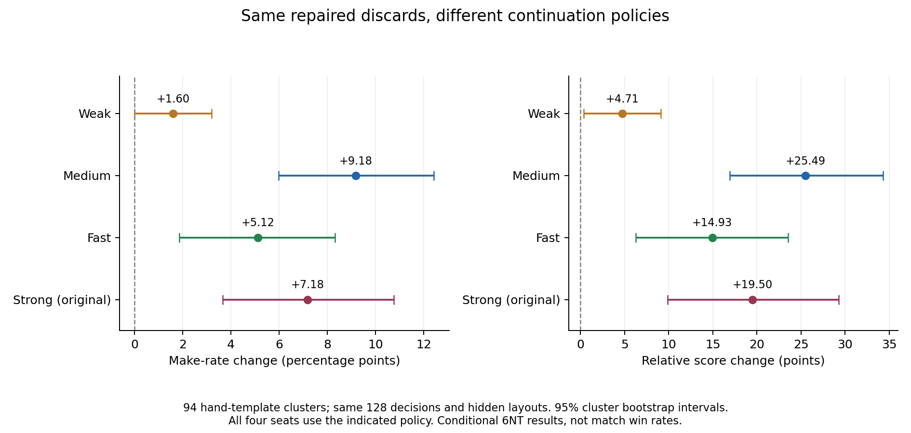

# 独立弃牌修补版与 Fast/Strong 续演比较

本轮保留无将弃牌修补，建立独立的 [StrongDiscardGuardBot](../../FiveHundredLab/Bots/FiveHundred/StrongDiscardGuardBot.cs)，profile 为 `strong-discard-guard-v1`。旧 bot 和前轮实验继续冻结。

**完成结果：Fast、Strong 续演下，修补的条件收益均为正；换用更强后续打法没有消除这一收益。** 本轮新增 4,096 副完整续演，与前轮共 8,192 副数据比较，但统计单位仍为同一批 94 种受影响手牌，不是 8,192 个独立样本。

## 保留的策略与接口

- 基准为仅 Misère 证明版，默认路径维持 32 样本搜索、原候选、改选门槛及 Medium 续演。
- 去掉弱牌强制 Pass；默认规则恢复基准搜索叫牌，显式规则配置保留基准原有规则版叫牌。
- 保留原样的无将 K 保护修补：仅修补新增的单张 K，保留搜索所保留的 A/Joker，替代静态估值不低于原选择减 0.5，不增加续演次数。
- 保留原公开 Misère 判断，没有加入普通合约关键墩证明。

```csharp
var rules = RuleConfiguration.Load(path); // null：原默认规则
var bot = new FiveHundredLab.Bots.FiveHundred.StrongDiscardGuardBot(seed: 7, rules: rules);
// 或 StrongDiscardGuardBot.FromConfiguration(path, seed: 7)
// 或 Profiles.CreateForRules("strong-discard-guard-v1", 7, rules)
```

构造和规则匹配检查与其他正式入口相同。`LastDiscardGuard` 记录实际返回的弃牌；`LastDefaultSearch` 是修补前的原搜索诊断，不伪造修补后的搜索估值。策略主体都在此 bot 文件中，不依赖旧 HandGuard 的策略实现。

三项新增测试覆盖叫牌/出牌与仅 Misère 基准一致、弃牌与冻结 HandGuard 一致、工厂及默认/六份配置的运行与重放。完整回归 **542 项通过**。另逐一重算上一轮选中的 128 个案例，原弃牌与修补弃牌全部一致，确认拆分不会改变本轮比较对象。

## 续演比较设计

本轮替换的是**固定弃牌后用于验证结果的后续出牌策略**。新 bot 内部候选搜索的续演模型保持原样；没有把 Fast/Strong 嵌入每一个候选的内部搜索。

沿用[上一轮扩大收益测试](../guard-benefits-v1-20261109/README.md)已固定的 128 个实际修补决策、94 种手牌、每个决策 8 组暗牌。原弃牌、修补弃牌、完整暗牌排列、各座位策略种子和合法 6NT 竞叫前缀全部不变，也不重新按结果选手牌。

| 续演策略 | 本轮处理 | 配对暗牌组 | 完整单副牌 |
|---|---|---:|---:|
| Weak | 读取前轮冻结数据 | 1024 | 2048 |
| Medium | 读取前轮冻结数据 | 1024 | 2048 |
| Fast | 新增运行 | 1024 | 2048 |
| Strong | 新增运行 | 1024 | 2048 |

四个座位均使用表中同一种策略，独立创建实例。Fast 使用原默认的分阶段预算和判断，Strong 使用原正式 Strong 的 8 样本配置，不替换为 All32/StrongPlus。两种弃牌在每一行中享有完全相同的续演预算；跨行差异同时包含策略、搜索和预算差异，不是单纯样本数消融。

仍先按每种手牌跨暗牌布局与决策种子求平均，再对 94 种手牌等权。95% bootstrap 区间按手牌模板聚类，不把累计 8,192 副牌当作独立手牌样本。Fast/Strong 相对 Medium 的收益差，也在**同一批手牌模板内配对**后估计区间，不能只凭两个独立区间是否重叠判断变化。

主指标为成约率变化、本队相对得分变化（本队单副得分减对方单副得分）；辅以多取墩数和两类手牌的分层结果。数据、完整手牌模板效应分别见 [summary.json](summary.json)、[template-effects.json](template-effects.json)。设计和源码哈希在开跑前登记于 [metadata.json](metadata.json)。

## 四种续演下的数据

下表均按手牌模板等权；数值限定于本批实际触发修补的固定 6NT 局面。

| 续演 | 原弃牌成约率 | 修补成约率 | 成约率变化（百分点），95% 区间 | 相对得分变化，95% 区间 |
|---|---:|---:|---:|---:|
| Weak | 49.14% | 50.73% | +1.60，0.00～+3.19 | +4.71，+0.35～+9.13 |
| Medium | 51.13% | 60.31% | +9.18，+5.98～+12.43 | +25.49，+16.91～+34.30 |
| Fast | 56.32% | 61.44% | **+5.12，+1.86～+8.31** | **+14.93，+6.24～+23.52** |
| Strong | 55.85% | 63.03% | **+7.18，+3.66～+10.77** | **+19.50，+9.89～+29.27** |

原始按布局计数的成约副数依次为 Weak 502→518、Medium 527→614、Fast 578→633、Strong 580→650，每个数字的分母为 1024。它们与手牌等权比率使用不同权重，不应混用计算区间。



对两种新增续演的“成约率、相对得分”四个主要端点，另作保守的 Bonferroni 区间补充：Fast 的成约率增益约 +0.93～+9.18 个百分点，Strong 约 +2.73～+11.70；两者仍为正。相对得分的补充区间也均为正。此补充采用同一手牌聚类 bootstrap，不改变样本或策略。

### 与 Medium 估计相比

| 对照 | 成约增益之差（百分点），配对 95% 区间 | 相对得分增益之差，配对 95% 区间 |
|---|---:|---:|
| Fast − Medium | −4.06，−7.98～−0.20 | −10.56，−20.91～−0.29 |
| Strong − Medium | −1.99，−6.52～+2.39 | −5.99，−17.93～+5.48 |

Fast 的点估计比 Medium 保守，未经多重校正的差值区间刚好落在零以下，应视为收益下降的迹象，而非确定的策略排序。Strong 的增益略小于 Medium，但配对差值区间跨零，不能确认两者收益存在可靠差异。无论这一模型差异是否成立，Fast/Strong 各自相对于原弃牌的增益都保留下来了。

### 两类手牌是否一致

| 续演 | 随机填牌族：50 种手牌，成约率变化 | 二张扰动族：44 种手牌，成约率变化 |
|---|---:|---:|
| Fast | +6.13 pp，95% +2.50～+9.75 | +3.98 pp，95% −1.70～+9.23 |
| Strong | +7.50 pp，95% +2.88～+12.00 | +6.82 pp，95% +1.56～+12.22 |

Strong 下两类手牌都呈正向且区间为正；Fast 下两类的点估计均正，但近邻扰动族的不确定性较大。因此收益并非只来自原场景附近的手牌，仍应保留构造手牌池的适用范围限制。

## 实现与验证结果

- 原来 128 个修补决策的“原弃牌、修补弃牌”均与独立新版本一致。
- 新增 4,096 副牌全部打完十墩并通过专用重放。
- 四种策略合计 4,096 组“原/新弃牌暗牌对”均核对布局一致；不同策略之间的完整牌序、起始手牌、kitty、弃牌选择、局面种子完全对应。
- 新版本完整回归 542 项通过，80 项冻结源码/模型校验通过。旧策略源码和参数未改。

完整验证明细见 [validation.json](validation.json)。八副 Fast/Strong 工具预检未计入主数据。

## 本轮判断

保留独立的弃牌修补版是合理的：正向证据不再仅来自 Medium 后续打法，在 Fast 和原 Strong 的后续出牌中也保留了可测的条件收益。修补本身没有增加候选续演次数，额外工作仍是静态留牌比较。

这支持把该规则作为有边界的结构性修补继续保留，不支持宣称新 bot 的总体比赛胜率提高 5～7 个百分点。此前自然比赛和不筛选弃牌观察中触发频率很低，本轮又专门选择了受影响手牌；实际胜率收益需要独立版本的端到端比赛另行估计。本轮没有再次运行完整比赛，也没有把测试结果用于调参或修改旧 bot。

## 解读范围

- 这是实际发生修补的受影响无将手牌族、固定 6NT 合约的条件收益，不是新 bot 的完整比赛胜率，也不是所有自然无将手牌的平均收益。
- 同时升级庄家、搭档和防守方，因此更强续演不必使绝对成约率单调增加；应比较同一策略行内“修补 − 原弃牌”的差值。
- 手牌池共享若干核心牌，包含原场景的近邻。原校准模板已排除，仍需保留分布限制；两种手牌族分层结果可检查是否只在原场景附近有效。
- 续演均为受限观察，不读取暗牌；测试夹具的牌序在传给策略前移除。每副十墩打完并完整重放。单副运行未到比赛终局时的 `Truncated=true` 不代表续演中断。
- Fast/Strong 的内部搜索仍有 Medium 系列续演依赖，四种方案并非完全无关的算法族；此结果是实际后续打法的敏感性验证，不是跨所有可能策略的保证。
- `results/continuations/*.game.gz` 使用 `FixtureArchive { Deck, Game }` 格式，需由本目录的专用验证器重放。它不是可直接交给普通 Arena CLI 的标准牌谱。

## 复现

需 .NET 8、Python NumPy/SciPy；绘图额外用 Matplotlib。仓库根目录执行：

```sh
dotnet build experiments/discard-rollouts-v1-20261109/Study.csproj -c Release
dotnet experiments/discard-rollouts-v1-20261109/bin/Release/net8.0/Study.dll experiments/discard-rollouts-v1-20261109/results validate
dotnet experiments/discard-rollouts-v1-20261109/bin/Release/net8.0/Study.dll experiments/discard-rollouts-v1-20261109/results run
python3 experiments/discard-rollouts-v1-20261109/analyze.py
python3 experiments/discard-rollouts-v1-20261109/plot.py
dotnet test TestBots -c Release --logger 'trx;LogFileName=discard-rollouts.trx' --results-directory /tmp/discard-rollouts-validation
python3 experiments/discard-rollouts-v1-20261109/verify.py
```

验证器核对四种策略的全部暗牌、初始手牌、两组弃牌、计分与重放；新版本使用 `frozen-profiles-v16.json` 冻结。既有策略不修改，也不混入前轮比赛胜率或重新选择表现更好的种子。未发布或上传仓库。
