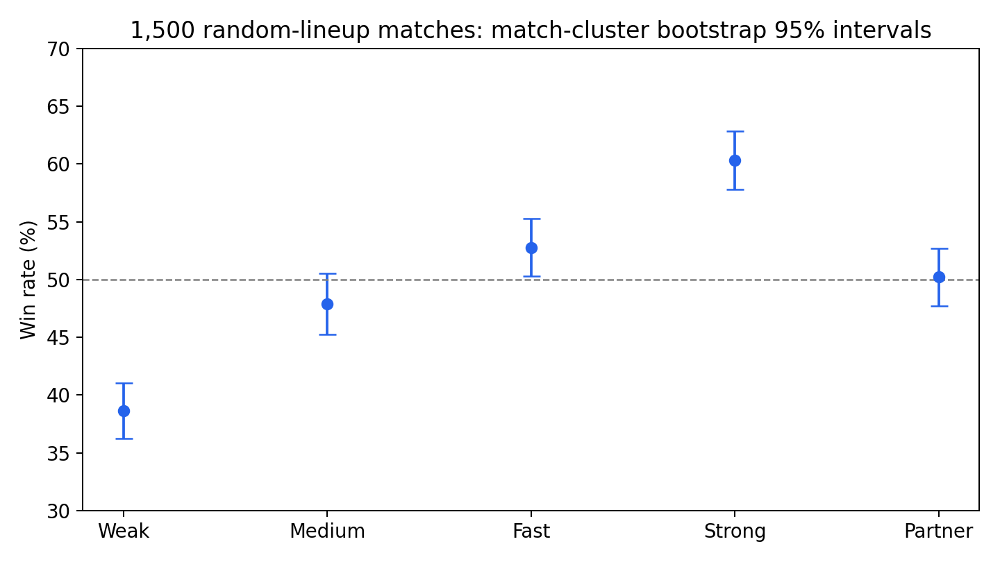
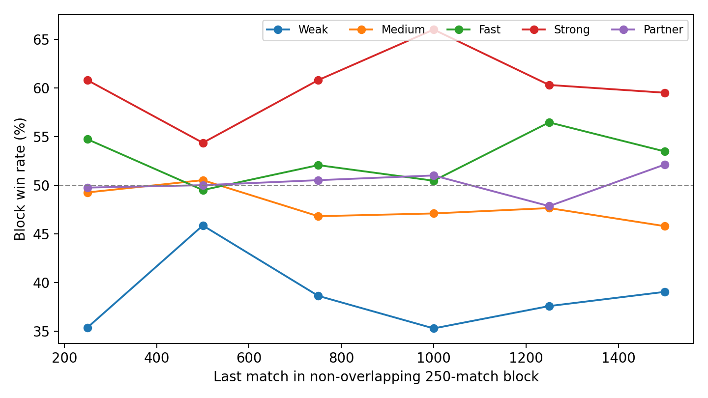

# 1,500 场 Five Hundred 随机对战胜率分析报告

日期：2026-11-05。分析对象：提交 `42b69e6` 的五种正式 bot，默认规则路径。

## 1. 结论

Strong 在本次随机阵容环境中有最明确的优势；Weak 明显落后。Fast 的观测胜率高于 Medium 和 Partner，但控制阵容并对十组比较作多重校正后，尚不足以确认这三者之间的稳定强弱次序。Partner 接近五成并不能否定其搭档体验目标；本实验未测真人体验。

这些结论限定于四人固定对家、原澳式默认规则，以及五种 bot 等概率随机占座的环境，不外推至所有变体或固定对手。规则版显式配置的策略路径未在本实验中评估。

## 2. 数据与实验设计

核对了全部 1,500 场编号、阵容、发牌种子、庄位、bot 种子及完整牌谱胜负。无异常或截断；执行 12,553 次发牌，其中 12,070 副进入打牌、483 副全 Pass 重发。新增各阶段的牌谱此前均已通过裁判重放。

- 每座位从 Weak、Medium、Fast、Strong、Partner 中独立等概率选择，允许重复；每座位单独实例和随机种子。
- 共 6,000 个座位参赛人次，胜方计 3,000 胜、负方计 3,000 负；一场比赛包含多副牌直到分数终局。
- 阵容种子20261105，发牌等参数种子流20261106，沿固定序列持续扩样，未按结果筛选种子。
- 1226 场含重复类型，23 场四座位全部同类。0/2 队赢 730 场，1/3 队赢 770 场；这不足以说明存在固定座位偏差。
- 四路并发运行，耗时受阵容、比赛长度与并发负载影响，不用于比较 bot 决策速度。

## 3. 原始胜率与不确定性

分母为该 bot 在已完成比赛中的座位参赛人次。同场两个相同 bot 分别计数；同队共享结果。95% 区间通过20,000次整场比赛 bootstrap 重采样估计，保留同场四个座位的相关性，而非将6,000人次当独立样本。固定伪随机实验下，这些区间是对同类随机比赛总体的探索性估计，依赖比赛间可视作独立抽样。

| Bot | 出现场数 | 参赛人次 | 胜／负 | 胜率 | 95%区间 |
|---|---:|---:|---:|---:|---|
| Weak | 869 | 1214 | 469/745 | 38.6% | 36.3%–41.0% |
| Medium | 867 | 1136 | 544/592 | 47.9% | 45.2%–50.5% |
| Fast | 891 | 1209 | 638/571 | 52.8% | 50.3%–55.3% |
| Strong | 899 | 1218 | 735/483 | 60.3% | 57.8%–62.9% |
| Partner | 885 | 1223 | 614/609 | 50.2% | 47.7%–52.7% |

Strong 相比 Medium 的原始差为约12.5个百分点，相比 Fast 约7.6个百分点。它们是在同一随机生态下的参赛胜率差，不等于 Strong 直接对阵二者的胜率。Fast 区间略高于50%不等于已经证明它优于某个具体 bot。比较两个类型应直接分析差值或建立阵容模型，不能只看区间是否重叠。

## 4. 阵容影响与辅助模型

建立每场一条记录的队伍逻辑回归：`P(0/2队获胜)=sigmoid(座位截距 + 本队两位bot强度之和 − 对手两位bot强度之和)`，Medium强度设为0以确定标尺。模型使用实际阵容计数，协方差采用比赛层面的 sandwich 稳健估计。十组两两检验用 Holm 方法校正。

这一模型假设搭档贡献在对数胜算上可加，未包含特定搭档协同、叫牌角色与非线性克制；稳健标准误不能消除模型设定偏差。以下是辅助推断，不是十组独立直接对战实测。

| 比较 | Holm校正p值 | 5%阈值下结论 |
|---|---:|---|
| Weak / Medium | 9.724e-06 | Medium较高 |
| Weak / Fast | 7.214e-12 | Fast较高 |
| Weak / Strong | 8.237e-23 | Strong较高 |
| Weak / Partner | 2.11e-08 | Partner较高 |
| Medium / Fast | 0.05198 | 未确认差异 |
| Medium / Strong | 3.812e-08 | Strong较高 |
| Medium / Partner | 0.3772 | 未确认差异 |
| Fast / Strong | 0.001526 | Strong较高 |
| Fast / Partner | 0.3772 | 未确认差异 |
| Strong / Partner | 1.528e-05 | Strong较高 |

将队友和两位对手重新按五种类型均匀枚举，并平均两种队伍方向后，模型得到的标准化胜率如下。它们接近原始胜率，说明整体名次并非仅由某种 bot 偶然拿到更好的阵容造成。

| Bot | 原始胜率 | 模型标准化胜率 |
|---|---:|---:|
| Weak | 38.6% | 38.6% |
| Medium | 47.9% | 48.1% |
| Fast | 52.8% | 52.8% |
| Strong | 60.3% | 59.9% |
| Partner | 50.2% | 50.6% |

## 5. 搭档条件下的表现

下表按焦点 bot 的搭档类型分组，单元格为胜率（人次）。同场观察仍相关；这些条件统计没有进一步平衡对手，不应将某单元格的高低直接解释为搭档协同或因果提升。

| 焦点bot \ 搭档 | Weak | Medium | Fast | Strong | Partner |
|---|---:|---:|---:|---:|---:|
| Weak | 30.7% (274) | 32.6% (218) | 41.7% (242) | 54.4% (241) | 34.3% (239) |
| Medium | 32.6% (218) | 46.7% (210) | 48.2% (222) | 60.5% (233) | 50.2% (253) |
| Fast | 41.7% (242) | 48.2% (222) | 49.2% (252) | 70.1% (244) | 54.2% (249) |
| Strong | 54.4% (241) | 60.5% (233) | 70.1% (244) | 55.6% (270) | 61.7% (230) |
| Partner | 34.3% (239) | 50.2% (253) | 54.2% (249) | 61.7% (230) | 50.8% (252) |

重复类型同时出现在两队，会稀释强弱差异；但若一队两位同类、另一队一位同类，同场并非强制50%，所以不能简单删除全部重复阵容来“校正”强度。主表保留所有合法阵容，辅助模型使用各队数量差。

## 6. 样本量与稳定性

将1,500场按原编号分为六个互不重叠的250场区块，避免把高度相关的累计检查点当作重复验证。bot在整个实验中没有学习或调参，区块变化主要反映阵容、牌运与抽样波动。

| 场次 | Weak | Medium | Fast | Strong | Partner |
|---|---:|---:|---:|---:|---:|
| 1–250 | 35.4% | 49.3% | 54.7% | 60.8% | 49.8% |
| 251–500 | 45.9% | 50.5% | 49.5% | 54.4% | 50.0% |
| 501–750 | 38.6% | 46.8% | 52.1% | 60.8% | 50.5% |
| 751–1000 | 35.3% | 47.1% | 50.5% | 66.0% | 51.0% |
| 1001–1250 | 37.6% | 47.6% | 56.5% | 60.3% | 47.8% |
| 1251–1500 | 39.0% | 45.8% | 53.5% | 59.5% | 52.1% |

此前30场检查点出现过极高或极低的局部胜率；这些小批次不能独立确定策略强度。继续增加同分布比赛可缩小误差，但若要回答Fast是否优于Medium、Partner是否保持强度，定向配对实验通常比继续混合抽样更有效。

## 7. 合约表现：诊断线索

按定约者的bot类型统计普通合约、Misère及Open Misère的成约数／承包数。普通合约依赖队友，且各bot主动选择的阶数、牌型与比分不同；成功率不能直接当作叫牌质量或综合强度排名。未主动叫零墩的bot记为“无”，不是失败。

| Bot | 普通合约 | Misère | Open Misère |
|---|---|---|---|
| Weak | 956/1101 (86.8%) | 无 | 无 |
| Medium | 1438/1898 (75.8%) | 2/2 (100.0%) | 无 |
| Fast | 1655/2063 (80.2%) | 2/3 (66.7%) | 无 |
| Strong | 2899/5023 (57.7%) | 无 | 无 |
| Partner | 1582/1980 (79.9%) | 无 | 无 |

## 8. 建议与交付

1. 将Strong作为当前默认规则下的强度基准；本报告不评价其计算成本是否划算。
2. 针对Fast/Medium、Partner/Fast做相同发牌、交换队伍与座位、平衡搭档的成对测试，按比赛或配对单位估计差值区间。
3. Partner继续单独运行体验场景及人类试玩；混合胜率不能测量信号回应、低级失误率或信任感。
4. 显式澳式、美式等规则配置另建实验，记录完整配置，避免与默认路径数据混合。

数据文件：

- [完整分析JSON](analysis.json)：胜率、区间、阵容模型、两两检验、搭档与合约统计。
- [分析脚本](analyze.py)：固定bootstrap种子20261107，可复算；图表使用Matplotlib。
- [原始计划](../plan.json)、[运行元数据](../metadata.json)、[累计汇总](../summary-1500.json)。逐场结果及压缩完整牌谱保存在上级目录。

汇总已采用不限编号位数的文件匹配，包含第1,000场之后的数据；本次重新核对了全部1,500场，而非仅沿用旧检查点。
