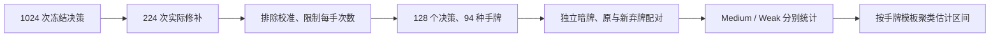
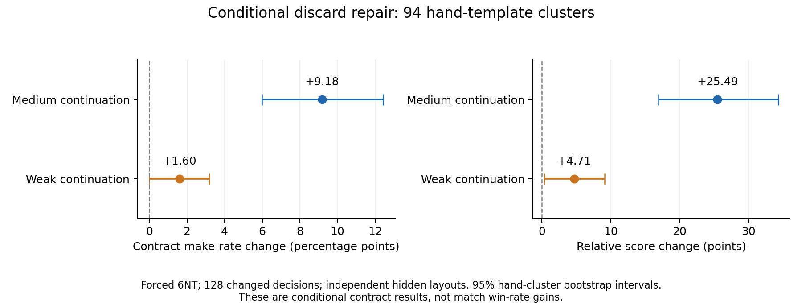

# 扩大样本：第四阶段修正是否有收益

本轮只测试冻结的 `strong-bid-guard-v1`、`strong-hand-guard-v1`，不改策略或参数。控制为第三阶段 `strong-misere-proof-v1`；弃牌部分另用叫牌版的原搜索选择作为控制。实验规模、筛选条件与停止规则在结果产生前写入 [metadata.json](metadata.json)。结果见 [summary.json](summary.json)。

**完成后的判断：无将弃牌修补有较明确的条件收益证据；弱牌强制 Pass 未显示收益；尚不能确认综合版的总体比赛胜率提升。** 不自动替换任何正式 bot。256 场比赛、4,096 副条件续演及 2,048 组相同暗牌对照均核验通过，79 项冻结源码/模型不变，详见 [validation.json](validation.json)。

## 三个不同的问题

1. **开叫条件触发时，直接 Pass 对完整比赛是否有益？** 64 组自然弱牌发牌、每组两个完整比赛，对比仅 Misère 基准与叫牌版。
2. **综合版在不筛选发牌的比赛里是否有益？** 64 组随机发牌、每组两个完整比赛，对比仅 Misère 基准与综合版。
3. **弃牌实际发生修补时，是否提高这副无将合约的结果？** 先固定待检查手牌与决策种子，只选择实际发生修补的情形，再使用未参与搜索或筛选的暗牌分配比较原弃牌与修补弃牌。

前两项共 256 场完整比赛；第三项是合约条件下的单副结果，不能当作比赛胜率，也不能把它的收益直接外推到所有无将手牌。

## 完整比赛设计

每对中测试者固定座位 0，对手与搭档分别从 Weak、Medium、Fast 中独立抽取，允许重复。相同发牌、相同起始庄家、相同其余三名 bot 及各座位策略种子；每个实例独立运行。比较的是测试者所在队伍在相同条件下的胜负变化，**不是两个版本直接对打的胜率**。

弱牌条件组先扫描 100,000 个自然种子，符合“没有 J/Q/K/A/Joker、没有五张长套”的初始手牌共 201 个（0.201%）；取前 64 个，固定庄家为 3，让测试者首先开叫，比分为零。此时满足冻结开叫判断的完整触发条件。未根据基准叫了什么或哪一组获胜筛选。

另按默认牌组作精确组合计数：符合条件的十张牌集合为 4,572,400 种，占 `C(43,10)` 的约 **0.2385%**（低牌四门分别为 6、6、7、7 张，各门至多取 4 张）。0.201% 是此次固定种子筛选的经验比例，0.2385% 是均匀发牌假设下的精确手牌比例；两者都只描述零分首先开叫的条件，不是比赛触发概率。

随机组使用另外 64 个固定种子，庄家轮换，不筛选手牌。每场 200 轮上限。随机组分析中，没有修正事件的成对比赛必须拥有逐字段一致的 `Rounds` 牌谱；所有成对比赛也核对共同发牌前缀一致。

每组的统计单位为 64 个发牌对，报告基准/新版各自胜场、由负转胜/由胜转负、成对差值和区间。精确检验使用不一致胜负对；保守区间由改善/恶化频率的 Clopper–Pearson 区间经 Bonferroni 合成。全无变化时普通 bootstrap 会退化，不能据此认定收益精确为零。

## 完整比赛结果

| 组别 | 基准胜场 | 新版胜场 | 配对胜率变化 | 配对 bootstrap 95% 区间 | 精确配对 p |
|---|---:|---:|---:|---:|---:|
| 弱牌条件：叫牌版 / 仅 Misère | 47/64 | 42/64 | −7.81 个百分点 | −21.88～+6.25 | 0.383 |
| 不筛选发牌：综合版 / 仅 Misère | 52/64 | 52/64 | 0 | bootstrap 退化，见下文 | 1.000 |

弱牌组 8 对由负转胜、13 对由胜转负、34 对双方都赢、9 对双方都输。更保守的 95% 区间为 −29.05～+14.45 个百分点。点估计不利于强制 Pass，但不能断言存在统计显著的退步；也没有支持胜率收益的证据。首副平均相对得分反而增加约 6.88 分，说明不能仅根据首副小幅得分或少量案例推断整场胜负。

随机组 64 个新版比赛均未触发开叫或弃牌修正，64 对完整 `Rounds` 内容逐字段一致。它核对了未介入时没有策略漂移，却无法估计修正本身的收益。全零差值的 bootstrap `[0,0]` 不能当作确定等价；保守 95% 区间仍为约 ±6.62 个百分点。这里的 52/64 也不是综合版对 Strong 的直接对打胜率，而是对相同 Weak/Medium/Fast 队伍条件的结果。

### 直接 Pass 不一定比最低叫牌更合理

在 64 个条件开叫局面中，基准本来就有 37 次 Pass；另外 27 次均叫六阶，没有开叫七阶以上。此前体验审计的 `prefer-pass` 是 Advisory 偏好，不能把它直接当成原策略犯错的证明。

一个可复盘例子是 `matches/weak-opening/pair-007`：测试者手中没有荣张，但有三张方块。基准叫 6D，搭档 Fast 先叫 7D，在对手 8S 后再叫 8D，并成功完成，本队首副得 280 分、对方得 20 分。新版开局 Pass 后，同一搭档叫 7D，在对手 8S 后退出，对手拿满全队十墩得到 250 分。最低叫牌在这里提供了搭档支持信息；没有荣张不代表没有竞叫或沟通价值。这只是具体机制案例，不表示所有差值都由该机制造成。

### 随机流变化也属于真实版本效果

新版的强制 Pass 省去了原搜索，未来的采样流随之不同。37 对首个动作本来都为 Pass、且只触发这一次判断的比赛中，仍有 10 对最终胜负变化（4 对有利、6 对不利）。这不能归因于首个 Pass 动作，因为两版动作相同。27 对真正改变首叫的比赛中，4 对有利、7 对不利。两组均不足以确认方向。

因此主结果回答的是“实际新版本的完整表现”，不是严格隔离随机数状态后的单一叫牌动作效应。若继续研究这条规则，应另设保留未来采样状态的动作隔离对照，或设计按阶段/局面确定采样的独立新版本；本轮没有中途改变随机流或重跑不满意的种子。

## 弃牌测试：先选决策，后看独立暗牌

原先 64 个普通无将随机观察均未触发修补，因此这一部分明确使用**针对受影响结构构造的手牌池**，不估计自然对局触发率：

- 共 256 个不同的十三张手牌模板，每个使用 4 个新决策种子，共 1,024 次原样搜索与修补判断。
- 模板 0 为原体验场景，仅校准，排除在主要续演统计之外。
- 其余包括 127 个在 `KS 5S AC QC AH` 周围随机填牌的模板，以及 128 个原场景的两张非核心牌扰动；模板按完整手牌去重。
- 共 224 次真正改变弃牌，涉及 144 种模板。按预定顺序、每种模板最多取 2 次、总数最多 128 次，最后选出 128 个决策，来自 94 种非校准模板。
- 每个决策再生成 8 组独立的完整对手手牌；原弃牌和修补弃牌使用同一暗牌分配，分别由全 Medium、全 Weak 继续打完十墩。共 `128×8×2种续演×2种弃牌=4,096` 副完整牌。
- 对实际修补案例额外调用原叫牌版核对，确认修补前选择与冻结原搜索完全一致。筛选不使用这些续演的结果，也不根据结果调整阈值。



每种手牌先跨暗牌布局和决策种子求平均，再对 94 种手牌等权估计收益。bootstrap 按手牌模板抽样，**不把 4,096 副牌当作 4,096 个独立手牌样本**。Medium 为主续演，Weak 为敏感性检查；不合并两种模型的样本。

## 弃牌结果

以下均限定在选中的受影响手牌族、固定 6NT 合约、实际发生修补的决策。

| 续演策略 | 原成约副数 | 修补成约副数 | 手牌等权成约率变化，95% 区间 | 本队相对得分变化，95% 区间 |
|---|---:|---:|---:|---:|
| Medium | 527/1024 | 614/1024 | +9.18 个百分点，+5.98～+12.43 | +25.49，+16.91～+34.30 |
| Weak | 502/1024 | 518/1024 | +1.60 个百分点，0.00～+3.19 | +4.71，+0.35～+9.13 |

“相对得分”指本队单副得分减对方单副得分，不是比赛胜负。原始成约副数按布局计数，收益和区间按手牌等权，所以两列原始比率相减不一定恰等于手牌等权收益。

Medium 下，两类手牌均呈正向：随机填牌族 50 种手牌约 +10.88 个百分点，二张扰动族 44 种约 +7.24 个百分点，相应聚类区间均为正。Weak 下收益明显较小，二张扰动族区间跨零。结果支持“修补在这批受影响的无将结构中有益”，并显示收益依赖后续打法；尚不支持“提高所有无将合约或完整比赛胜率相同幅度”。Weak 的小幅正向也不应经多组比较后被当作充分确认的普遍效应。



## 复盘、信息隔离与数据格式

256 场比赛使用原引擎和原默认规则，`matches/` 下 `.game.gz` 是标准 `GameRecord`。

定向弃牌为了固定手牌、独立重分暗牌，使用只改变发牌前牌序的测试夹具。**所有策略收到的观察都被替换为普通默认 Rules，夹具牌序从不传给 bot**；各方只知道正常可见信息。测试同时逐字段核对续演起点的弃牌观察与筛选观察相同。合约通过合法 6NT/Pass 脚本固定，后续全程合法执行。

`continuations/` 下 `.game.gz` 是 `FixtureArchive { Deck, Game }`，完整保存发牌夹具和正常化后的牌谱，必须使用本目录的 `verify` 模式重放，不能直接丢给普通 Arena CLI。每副在写盘前即重放检查，最终还将从磁盘整体读回核验。单副十墩打完而未到比赛终局时，`Game.Truncated=true` 是此处单轮上限的正常含义，不代表弃牌续演中断。

## 限制

- 弱牌组有意提高极少见触发手牌的比例。0.201% 是固定零分首先开叫时的自然手牌频率，不是完整比赛中事件频率；实际频率还取决于叫牌位置、比分和历史。
- 直接 Pass 会在默认永久 Pass 规则下放弃本轮继续竞叫的资格。低牌也可能适合稍后竞叫 Misère，或用最低叫牌改变后续竞价；不能因“低牌”就先验认定原搜索的六阶叫牌是错误。
- 弃牌手牌池共享若干核心控制牌，包含已知场景的近邻，不代表自然无将分布。排除原校准场景、独立暗牌与两类手牌分层可降低单一场景依赖，但不能消除分布限制。
- 续演使用 Medium/Weak，虽未用到搜索内部暗牌样本，但 Medium 仍接近原搜索的固定续演模型。实际人类搭档、更强对手和其他变体还需要另外验证。
- 罕见事件即便条件收益较大，也未必可见地改善总体比赛胜率。随机组与定向组分开报告，不拼接成一个“总胜率”。

## 继续开发的建议

1. **保留无将修补作为候选改进。** 在两类新手牌中，Medium 续演的条件收益都较清楚；Weak 下收益较小，说明需关注对手和搭档的打法。下一次实现可建立仅含弃牌修补、继承仅 Misère 基准的新独立版本，将它与开叫规则彻底分开，而不改当前冻结版本。
2. **暂不把强制 Pass 作为默认强度增强。** 本轮没有正向胜率证据，且观察到最低叫牌的搭档沟通价值。不要为了让 `prefer-pass` 单项审计全通过而覆盖正常搜索；若保留，可明确视为保守体验偏好，并单独验证竞叫资格、搭档支持及随机流影响。
3. **不宣传综合版总体胜率提升。** 这次足以分析受影响无将手牌的条件收益，但随机组没有触发事件，仍不足以估计它在正常比赛中的绝对胜率增幅。进一步验证应围绕真实竞叫后出现的受影响无将手牌及更强续演策略，不宜把构造手牌池中的 9.18 个百分点直接用于总体预测。

本轮不新增或修改 bot，也没有发布或上传 GitHub。原有 539 项回归测试结果沿用；本次冻结策略未改，因此没有重复跑整套回归。新增测试工具通过了预检、全量合法决策重放、相同暗牌/初始手牌/弃牌核对及 79 项冻结校验。

## 复现

需 .NET 8、Python NumPy/SciPy。仓库根目录执行：

```sh
dotnet build experiments/guard-benefits-v1-20261109/Study.csproj -c Release
dotnet experiments/guard-benefits-v1-20261109/bin/Release/net8.0/Study.dll experiments/guard-benefits-v1-20261109/results matches
dotnet experiments/guard-benefits-v1-20261109/bin/Release/net8.0/Study.dll experiments/guard-benefits-v1-20261109/results select
dotnet experiments/guard-benefits-v1-20261109/bin/Release/net8.0/Study.dll experiments/guard-benefits-v1-20261109/results continue
python3 experiments/guard-benefits-v1-20261109/analyze.py
python3 experiments/guard-benefits-v1-20261109/plot.py
python3 experiments/guard-benefits-v1-20261109/verify.py
```

运行器程序集哈希保存在 `runner-version.txt`，不同版本不能混入同一目录。已完成任务可跳过；输出写盘后再原子替换结果文件。预检额外使用 32 副夹具续演验证工具，未混入主数据。整个测试期间不修改或发布 bot。
