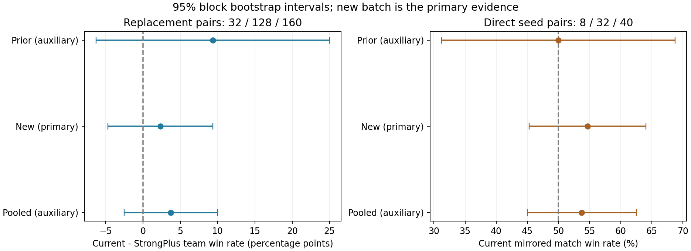
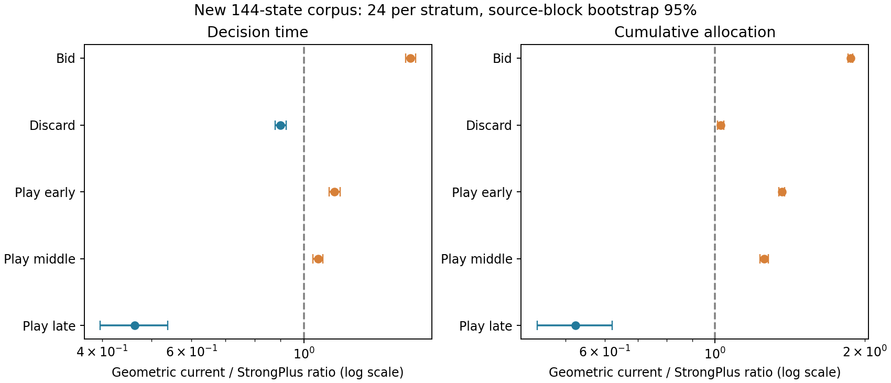

# 新版与 StrongPlus 扩大测试：新增 320 场

当前版为 `strong-play-incremental-v1`，对照为 `strong-plus-v1`。两版策略、规则、预算与源码哈希均与上一轮一致，本轮没有调参、换用 Strong 内部续演或修改 bot。

**新批次尚未确认两版存在胜率差异；不显著不等于证明等价或证明不下降。** 本报告首先分析预先固定的新批次；旧 80 场仅在辅助汇总中出现。成本在新增语料上重新串行测量，不混用旧日期的绝对耗时。

## 设计与验证

- 新增相同阵容替换：128 个独立发牌—阵容组，每组运行两版，共 256 场。测试者席位、庄家各位置 32 次，其他三席从 Weak/Medium/Fast/Strong/Partner 独立均匀抽取，可重复。每组的发牌、其他三席、全部种子与庄家相同。
- 新增直接对战：32 个独立种子，每种子互换两版席位，两队均搭档 Medium，共 64 场。目标 bot 种子跟随身份，搭档种子跟随物理席位。
- 默认规则，200 轮上限，不筛手牌；事前固定新增 320 场，不因中间胜负或显著性停止。所有新种子与上一轮不重叠。比赛按计划序号分成四个单工作进程运行，累计耗时只作描述；成本测量等全部对局结束后进行。
- 成本：144 个新公开局面，叫牌、弃牌、前期、中期、后期、唯一合法出牌各 24 个，每层各 12 个来自两版轨迹。每来源比赛每层取首个合格状态，交替来源优先级；排除旧 46 个局面和重复公开观察。每状态三次、交替执行版本、固定打乱状态顺序。
- 重复测量先在每状态内取中位数；同一发牌组内的来源状态相关，耗时/分配比先按来源发牌组汇总，再做组级 bootstrap。比例大于 1 表示当前版成本更高。各成本端点属于探索性结果，区间未作多重比较校正。

方案、输入与源码哈希见 [registration.json](results/registration.json)、[plan.json](results/plan.json)、[micro-registration.json](results/micro-registration.json)。运行环境见 [runtime.txt](results/runtime.txt)，来源提交见 [source-commit.txt](results/source-commit.txt)。

## 胜率：新批次为主要结果

| 版本 | 胜 / 负 / 截断 | 正常结束比赛胜率 | 精确 95% 区间 |
| --- | --- | --- | --- |
| 当前增量版 | 90 / 38 / 0 | 70.31% | 61.60%～78.06% |
| StrongPlus | 87 / 41 / 0 | 67.97% | 59.15%～75.94% |

完整替换配对 128 组：当前版由负转胜 12 组、由胜转负 9 组，同赢 78、同输 29。

配对胜率差为 **+2.34 个百分点**；配对发牌组 bootstrap 95% 区间 **-4.69～+9.38 pp**，精确配对检验 p=0.6636。更保守的 CP/Bonferroni 差值范围为 -9.37～+13.88 pp。

这是测试者所在队在随机混合阵容中的表现，不是两版直接对打胜率。单行胜率按正常结束比赛计；配对分析仅使用双方都结束的组。

最终本队相对得分的配对平均变化 +25.70 分，95% 区间 -72.73～122.27。平均轮数差 +0.28。最终得分受终局停止影响，不替代胜负。

### 新增直接对战

正常结束 64 场、截断 0 场；当前版 **35 胜**，StrongPlus **29 胜**，原始胜率 54.69%。完整种子对 32 组，其中当前版双胜 7、StrongPlus 双胜 4、互胜 21。

按完整种子对聚类，当前版胜率估计 54.69%，95% 区间 45.31%～64.06%。同一对的两场不当作独立样本。

## 与上一轮及合并结果对照

| 批次 | 替换配对数 | 当前版胜场 | StrongPlus 胜场 | 配对胜率差 | 配对 bootstrap 95% 区间 |
| --- | ---: | ---: | ---: | ---: | --- |
| 旧批次（辅助） | 32 | 25 | 22 | +9.38 pp | -6.25～+25.00 pp |
| 新增（主要） | 128 | 90 | 87 | +2.34 pp | -4.69～+9.38 pp |
| 合并（辅助） | 160 | 115 | 109 | +3.75 pp | -2.50～+10.00 pp |

合并直接对战：当前版 43 胜、StrongPlus 37 胜，共 80 个结束的比赛、40 个完整种子对；聚类胜率 53.75%，95% 区间 45.00%～62.50%。

策略源哈希一致且新旧种子不重复，但旧样本已用于提出扩大测试，因此以独立新增批次为主要依据；合并结果只辅助观察稳定性。环境/日期不同，不合并两批绝对毫秒数。胜率差“不显著”也不能作为严格不劣于某个阈值的证明。



## 新语料的串行成本

旧版 StrongPlus 默认 LastRollouts 包装计数为 0，本轮继续从新生成的 SearchReport.Samples×Candidates 推算搜索次数，排除陈旧报告；当前版使用实际计数。此差别保留在原始遥测中。

下表的耗时和分配量为状态中位数；比值先在同一状态配对，再按来源发牌组等权汇总对数比，得到几何平均及来源组 bootstrap 区间。因此比值不等于两列中位数直接相除。

| 阶段 | 状态 / 来源发牌组 | 耗时 ms：当前 / Plus | 当前/Plus 耗时几何比（95%） | 分配 MB：当前 / Plus |
| --- | --- | ---: | --- | ---: |
| 叫牌 | 24 / 12 | 297.065 / 180.188 | 1.625（1.588～1.664） | 564.667 / 300.466 |
| 弃牌 | 24 / 14 | 551.250 / 588.931 | 0.900（0.878～0.924） | 1055.238 / 1049.416 |
| 前期出牌 | 24 / 12 | 228.756 / 202.984 | 1.149（1.122～1.179） | 418.912 / 312.070 |
| 中期出牌 | 24 / 12 | 82.221 / 79.057 | 1.068（1.042～1.091） | 156.256 / 127.326 |
| 后期出牌 | 24 / 12 | 9.617 / 13.151 | 0.464（0.396～0.539） | 18.927 / 22.380 |
| 唯一合法出牌 | 24 / 12 | 0.000 / 0.009 | 不推断微秒比率 | 0.000 / 0.009 |



后期优势受局面构成影响：其中 8 个状态仅余两张手牌、两种合法动作，两版均执行 64 次续演；当前版可跳过后续唯一合法动作。这不是搜索预算减少带来的收益。成本语料的出牌和弃牌均为普通合约，不能据此推断 Misère 成本。

分配量为累计申请对象字节数，不是峰值内存。三次计时重复不当作三个独立局面，两个策略轨迹来自相同种子的情况也归同一来源组。等额分层并不代表自然出牌频率，不据此计算整场总体加速比例。原始数据另保存每层来源两版的敏感性结果与搜索预算。

| 阶段 | 续演数中位数：当前 / Plus | 不同行为的固定状态数 |
| --- | ---: | ---: |
| 叫牌 | 192 / 192 | 3 / 24 |
| 弃牌 | 384 / 768 | 2 / 24 |
| 前期出牌 | 288 / 288 | 1 / 24 |
| 中期出牌 | 192 / 192 | 0 / 24 |
| 后期出牌 | 96 / 96 | 1 / 24 |
| 唯一合法出牌 | 0 / 0 | 0 / 24 |

成本是完整版本的比较，不是纯粹缓存消融：两版弃牌宽度（12/24）、置信门槛（8+0.75SE / 6+1.0SE）、Medium 适配变体和公开 Misère 判断不同。源码差异详见[上一轮策略报告](../incremental-vs-strongplus-20261109/README.md)。StrongPlus 的策略实例缓存和省略 PlayedCards 明细仍是成本差异的重要待剖析来源；本轮未替换任何实现。

## 行为与自然曝光

128 个替换组中，110 组出现测试者首次分歧，分布为 {'discard': 20, 'bid': 35, 'play': 55}。共对齐 5324 个公开观察，动作相同 5185、不同 139。首次分歧前观察相同已核对；后续随机流位置可能不同，这些动作不是独立强度样本。

当前版自然弃牌修补在替换测试中触发 0 次。不能将两版总体差异直接归因于补丁或任何一个组件；完整场景与比较见 [comparisons.json](results/comparisons.json)。

各合约类别、本队承接和破约、阶段总耗时/均值/P50/P95/分配及来源配对差异均保存在 [summary.json](summary.json)。自然比赛并发且轨迹不同，其耗时不与同局面串行成本混用。

## 后续判断

1. 胜率判断以新批次区间和配对检验为准；不根据点估计挑选有利阵容、剔除长局或更改预算。
2. 工程方向继续由同局面成本定位：可研究完整规则/将牌/Joker 键下的策略只读派生缓存，以及确认未被消费的接口字段能否按需构造；需另起版本并做行为等价测试。
3. 若要作严格不劣效判断，应事先给出容忍下降幅度；本轮置信区间不能自动解释成“同样强”。规则变体与罕见 Misère 的强度仍需专项验证。

## 数据与复现

本轮验证：320 个实际比赛，截断 0；全部权威引擎回放通过。40806 个测试者动作匹配实际记录；144 个新公开状态、432 次配对测量的来源、合法性、重复确定性与预算来源均核对通过。565 项整体回归通过；92 个冻结文件校验通过。

原始比赛位于 `results/replacement`、`results/direct`，每场保存牌谱、遥测、指标；固定成本语料与逐次计量位于 `micro-cases.json`、`micro-benchmark.json`。最终核对见 [validation.json](validation.json)。

从仓库根目录，需 .NET 8、Python NumPy/SciPy；绘图需 Matplotlib：

```sh
dotnet build experiments/incremental-vs-strongplus-expanded-20261110 -c Release
# 新目录准备一次；四个 run 进程可并发，索引互斥：
dotnet experiments/incremental-vs-strongplus-expanded-20261110/bin/Release/net8.0/Study.dll /tmp/inc-plus-expanded-new prepare
dotnet experiments/incremental-vs-strongplus-expanded-20261110/bin/Release/net8.0/Study.dll /tmp/inc-plus-expanded-new run 0 4
# 另三个进程分别用 run 1 4、run 2 4、run 3 4
# 以下默认处理本目录 results；旧文件先备份：
dotnet build experiments/incremental-vs-strongplus-expanded-20261110/micro -c Release
# micro prepare 仅首次执行；bench 在所有对局结束后串行运行：
# dotnet experiments/incremental-vs-strongplus-expanded-20261110/micro/bin/Release/net8.0/Bench.dll prepare
dotnet experiments/incremental-vs-strongplus-expanded-20261110/micro/bin/Release/net8.0/Bench.dll bench
python3 experiments/incremental-vs-strongplus-expanded-20261110/verify.py
python3 experiments/incremental-vs-strongplus-expanded-20261110/analyze.py
python3 experiments/incremental-vs-strongplus-expanded-20261110/plot.py
python3 experiments/incremental-vs-strongplus-expanded-20261110/report.py
```

生成器记录程序集哈希以防续跑混入不同版本；权威回放脚本不要求跨机器生成器二进制相同。`COMPARISON_TRX` 可指定本轮测试 TRX，默认 `/tmp/strongplus-expanded-validation/full.trx`；`DOTNET` 可指定可执行文件。所有策略源码保持冻结。
