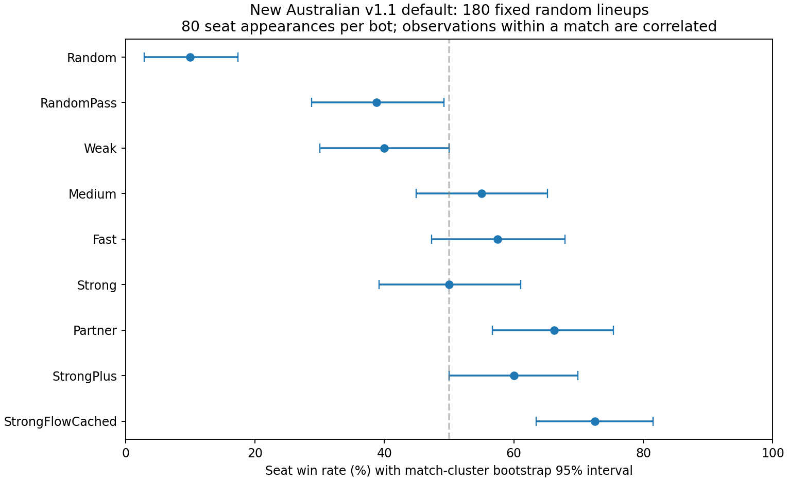
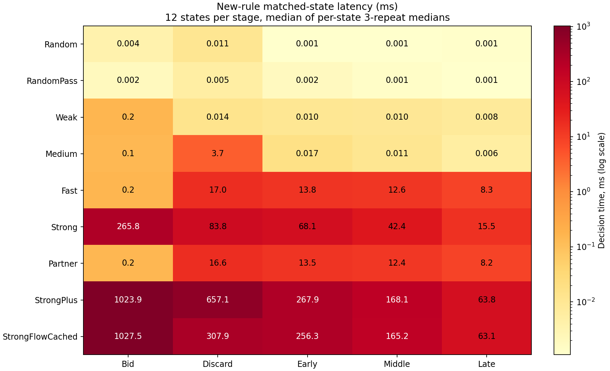

# v1.1 新澳式默认规则：实现与九版 Bot 比较

日期：2026-11-10（北京时间）。依据用户上传的版本需求草案实施规则与九个 bot 的对应更新，并在新规则下重新评估。旧版策略及旧规则数据保持历史身份；本报告没有将旧实验的胜率当作新规则成绩。

## 结果与范围

新默认、主要变体与对应交互已实现。采用命名空间 `FiveHundredLab.Bots.FiveHundred.V11` 和 `-v1.1` 工厂名称，原 bot 文件保留冻结副本；规则说明及逐项对应见 [v1.1 规则文档](../../FiveHundredRules/v1.1/README.md)。

固定 180 场随机阵容已全部正常结束并通过最终引擎回放；每版 80 个座位参赛人次、每个物理席位 20 次。Flow 的点估计为 58/80，Partner 为 53/80；必须结合下面的区间与同场相关性解读，不当作两版直接对战胜率。

## 规则与实现变化

澳式默认仅调整文档要求的选项：Open Misère 在 10♦/10♥ 之间、首墩完成后明牌；Joker 在无将/零墩中的领门、跟牌、缺门强制与所有活动持有者的可选提名；新特殊合约默认关闭，重发换庄开启。未要求变化的逐张发牌、固定初庄、7/8 阶竞叫资格、计分与终局保留。美式另有一份按 3.2 落实的完整预设。
新增 Ace–no face、庄家强制叫牌/全 Pass 重发/无合约 NT 三种处理、各竞叫序位、Joker 历史条件、No Pickup、Grand Nullo、Grand Slam；新的申请/宣告/交牌接口保留明确的合法动作和私有信息边界。用户确认的 2.6 笔误、Grand 紧随 Open 与所有持有者提名已落实。
本仓库没有游戏设置界面；草案的按钮/弹窗需求落实为配置与玩家回调接口，未虚构界面实现。

### 对九个 bot 的迁移

| Bot | v1.1 保留的定位及适配 |
| --- | --- |
| Random | 所有行为从合法动作中随机；新申请、Grand Slam 与交牌也可随机 |
| RandomPass | 正常永远 Pass；强制庄家时改为最低合法叫牌，避免非法动作；其余仍随机 |
| Weak | 局部估值与即时争墩；双人零墩按全队躲墩，不把队友吃墩当成保护 |
| Medium | 采用规则感知的确定性判断，按新 Joker、队伍目标和分值决策；保守处理独战声明 |
| Fast | 小候选、少量世界；新规则路径使用 4 世界、最多4候选的配置搜索 |
| Strong | 保留搜索叫牌，8 世界、12弃牌候选、8+0.75SE；续演执行新规则 |
| Partner | Fast基础上的公开破约、搭档保牌/信号和弃牌修补；证明加节点上限 |
| StrongPlus | 32世界、24弃牌候选、6+1.0SE，公开零墩证明，执行新规则续演 |
| StrongFlowCached | 32世界、12弃牌候选、8+0.75SE、弃牌修补与证明；根决策内缓存规则派生牌表及历史快照 |

新默认走 v1.1 规则感知策略，包含对续演和估值的适配；这不是“仅替换规则、不改策略实现”的消融。Medium 新规则路径不是原平台默认策略的逐动作复制。旧规则下的原策略依然保留，不能用两批原始百分比推断规则调整的单独因果效果。

## 胜率：九版随机阵容生态

每个席位独立打乱 20 份九版 bot 的清单，组成事前固定的 180 场阵容，允许重复；每席独立实例与种子，同队共同获胜。样本固定，无结果筛选、无显著性提前停止，最大200副。置信区间按整场比赛重采样20,000次，保留同场重复类型及队友结果相关性；固定平衡阵容下属于探索性估计。

| Bot | 胜 / 负 | 胜率 | 整场 bootstrap 95% |
| --- | ---: | ---: | --- |
| Random | 8 / 72 | 10.00% | 2.90%～17.33% |
| RandomPass | 31 / 49 | 38.75% | 28.77%～49.21% |
| Weak | 32 / 48 | 40.00% | 30.00%～50.00% |
| Medium | 44 / 36 | 55.00% | 44.87%～65.22% |
| Fast | 46 / 34 | 57.50% | 47.30%～67.86% |
| Strong | 40 / 40 | 50.00% | 39.19%～61.04% |
| Partner | 53 / 27 | 66.25% | 56.67%～75.41% |
| StrongPlus | 48 / 32 | 60.00% | 50.00%～69.86% |
| StrongFlowCached | 58 / 22 | 72.50% | 63.41%～81.48% |



### Flow 与其他版本的参赛胜率差

这是同一生态中两种类型的原始参赛胜率差，已按比赛整体重采样，仍不是成对直接对打或控制所有搭档后的因果差。区间未作多重比较校正。

| 比较 | Flow − 对照 | 95% 区间（百分点） |
| --- | ---: | --- |
| Flow / Medium | +17.50 pp | +2.78～+32.20 |
| Flow / Fast | +15.00 pp | +0.67～+29.28 |
| Flow / Strong | +22.50 pp | +7.62～+37.20 |
| Flow / Partner | +6.25 pp | -7.26～+19.82 |
| Flow / StrongPlus | +12.50 pp | -1.61～+26.30 |

本轮有 Random 与 RandomPass，而旧1500场只有 Weak/Medium/Fast/Strong/Partner；规则与策略路径也改变。不可直接把旧胜率和本轮相减来解释为提升或退步。Strong 在当前样本不再有旧生态中的点估计优势，不等于已证明它在任意搭档/规则下弱于 Medium。

自然样本共 1187 次发牌、335 次重发，852 副进入打牌；只有 2 个普通 Misère，没有自然 Open Misère，No Pickup/Grand/Slam 默认关闭。罕见合约的正确性依赖专项测试，不能从这批自然胜率推断其策略强度。

## 同局面串行成本

从本轮保存对局经权威回放获取新公开局面，六层各12个、共72个；每局每层取首个合格状态，去重而不按赢家筛选。每状态3次，9版共1,944次决策。新实例与同种子，实例构造不计时，根决策内缓存计入；全部比赛和前一轮完整回归结束后串行测量。后来的独立兼容测试不与计量重叠。

| Bot | 叫牌 ms | 弃牌 ms | 前期 ms | 中期 ms | 后期 ms |
| --- | ---: | ---: | ---: | ---: | ---: |
| Random | 0.004 | 0.011 | 0.001 | 0.001 | 0.001 |
| RandomPass | 0.002 | 0.005 | 0.002 | 0.001 | 0.001 |
| Weak | 0.155 | 0.014 | 0.010 | 0.010 | 0.008 |
| Medium | 0.139 | 3.670 | 0.017 | 0.011 | 0.006 |
| Fast | 0.157 | 16.979 | 13.842 | 12.627 | 8.253 |
| Strong | 265.797 | 83.780 | 68.082 | 42.433 | 15.550 |
| Partner | 0.154 | 16.605 | 13.502 | 12.365 | 8.234 |
| StrongPlus | 1023.907 | 657.057 | 267.915 | 168.147 | 63.832 |
| StrongFlowCached | 1027.545 | 307.936 | 256.306 | 165.228 | 63.123 |



| Bot | 叫牌分配 MB | 弃牌分配 MB | 前期分配 MB | 中期分配 MB | 后期分配 MB |
| --- | ---: | ---: | ---: | ---: | ---: |
| Random | 0.000 | 0.000 | 0.000 | 0.000 | 0.000 |
| RandomPass | 0.000 | 0.000 | 0.000 | 0.000 | 0.000 |
| Weak | 0.072 | 0.001 | 0.001 | 0.001 | 0.001 |
| Medium | 0.072 | 2.180 | 0.003 | 0.002 | 0.002 |
| Fast | 0.072 | 9.871 | 7.617 | 6.987 | 4.681 |
| Strong | 150.641 | 48.296 | 37.874 | 24.426 | 9.332 |
| Partner | 0.072 | 9.871 | 7.811 | 7.121 | 4.740 |
| StrongPlus | 594.973 | 370.619 | 151.652 | 97.666 | 37.258 |
| StrongFlowCached | 593.750 | 183.853 | 149.675 | 96.814 | 37.136 |

表为每状态三次中位数再按状态取中位数；累计对象分配不是峰值内存。极短调用低于计时分辨率时不推断比例。不能把这批新规则与旧规则、不同运行条件的绝对毫秒数拼接比较。

### Flow / StrongPlus 配对耗时比

先对同一状态配对，再按来源比赛等权汇总对数比；来源比赛 bootstrap 95% 区间。比值<1表示Flow更快，不是两列中位数相除。

| 阶段 | 配对几何比 | 95% 区间 |
| --- | ---: | --- |
| bid | 0.992 | 0.968～1.012 |
| discard | 0.463 | 0.448～0.479 |
| early | 0.940 | 0.918～0.966 |
| middle | 0.975 | 0.947～1.004 |
| late | 0.987 | 0.971～1.001 |

弃牌阶段还包含12对24个静态候选的预算差异。等额分层不是自然调用频率，不合成为整场加速。Flow的纯缓存行为一致性在专项测试中与无缓存规则续演逐步核对；不把所有版本间成本差都归因于缓存。

## 体验检查

17个原始牌局脚本使用新引擎重新走到目标状态，全部可达，无排除；为控制初始分配，测试专用牌序反解洗牌，随后恢复规范牌序供采样。公开Joker提名在脚本中主动取消。每场景两种种子×两种手牌顺序，每版68次，共612次；没有非法动作或异常。Critical/Advisory/Control分开，不合成为真人满意度。

| Bot | 明确约束 | 战术/约定提示 | 控制场景 |
| --- | ---: | ---: | ---: |
| Random | 16/28 | 17/40 | 4/4 |
| RandomPass | 18/28 | 27/40 | 4/4 |
| Weak | 24/28 | 26/40 | 4/4 |
| Medium | 24/28 | 36/40 | 4/4 |
| Fast | 24/28 | 36/40 | 4/4 |
| Strong | 24/28 | 36/40 | 4/4 |
| Partner | 28/28 | 40/40 | 4/4 |
| StrongPlus | 28/28 | 36/40 | 4/4 |
| StrongFlowCached | 28/28 | 36/40 | 4/4 |

Joker必须埋掉的检查按本探针不提名的条件解读；在允许命名的完整策略空间中不是普遍定理。除随机版本外，当前bot主动取消可选提名，处理其他人公开提名的行为已适配，但主动提名策略仍可改进。Partner通过全部体验代理检查，仍是以真人搭档为目标时最直接的候选。Flow/Plus通过所有明确约束，但未完整实现“给已显示缺门的队友提供将吃”的约定提示。脚本曾参与开发、样本只有两种种子；不把探针通过率当自然实战失误率。

## 综合判断

Flow 当前点估计最好，但对 Plus 和 Partner 的胜率差区间仍跨过零，不能宣布稳定领先。对 Strong 的原始差有优势迹象，区间仍是未作多重校正的探索性结果。Partner以更低成本通过全部体验探针，是当前真人队友的优先候选。
新默认下 Flow/Plus 的叫牌与中后期耗时基本相近；弃牌差异较大但包含候选预算，前期为小幅改善。旧平台适配层的缓存收益不能直接搬到新的配置规则执行路径；现在每次续演新建 Medium 会重复校验配置，是代码中可见的下一轮工程热点，本轮没有把预期优化计入结果。

## 验证、限制与后续

完整回归 582/582 通过；新增配置版本保护另有 4 项针对性回归通过。180场最终引擎重放、72状态重复确定性、612次体验合法性与源码指纹均核验。冻结文件 114 项通过；被扩展的旧引擎/模型/规则/回放源码以原始字节保存在 Archive/v1，对应旧哈希改指向这些快照，而非用新哈希覆盖历史。

赛后仅修补“旧 IPlayer 没实现可选申请接口时记录默认拒绝”的 Ace–no face 回放兼容，并增加未带v1.1版本标记却启用新选项的拒绝检查。9个被测bot都实现该接口，且默认Ace–no face关闭；bot策略、默认规则和计量代码没有改变。生成源码快照、生成/最终哈希与影响说明保存在 provenance，最终引擎独立回放全部记录一致。

后续优先事项：增加独立种子验证Flow/Partner/Plus差异；对Open Misère与三种新特殊流程做单独策略评估；针对新的规则续演继续减少配置/牌表重复工作。当前样本不证明跨变体的完整强度排序，也不证明所有自定义组合永无死局。

数据：[summary.json](summary.json)、[validation.json](results/validation.json)、[计划](results/plan.json)、[注册](results/registration.json)、[体验明细](../rules-v1-1-ux-20261110/results.json)。每场完整牌谱为 results/game-NNN.game.gz，包含审计隐藏牌，不能在对局时传给玩家。

复现需 .NET 8、Python NumPy（图表另需Matplotlib）。从仓库根目录先备份结果：

```sh
dotnet test TestBots -c Release --logger "trx;LogFileName=full-v11-release.trx" --results-directory /tmp/rules-v11-tests
dotnet build experiments/rules-v1-1-20261110 -c Release
# prepare仅首次；run 0/1/2/3分别处理互斥分片
dotnet experiments/rules-v1-1-20261110/bin/Release/net8.0/Study.dll prepare
dotnet experiments/rules-v1-1-20261110/bin/Release/net8.0/Study.dll run 0
# 全部对局、测试结束后再串行计量
dotnet experiments/rules-v1-1-20261110/bin/Release/net8.0/Study.dll micro
dotnet run --project experiments/rules-v1-1-ux-20261110 -c Release
python3 experiments/rules-v1-1-20261110/analyze.py
python3 experiments/rules-v1-1-20261110/plot.py
```
