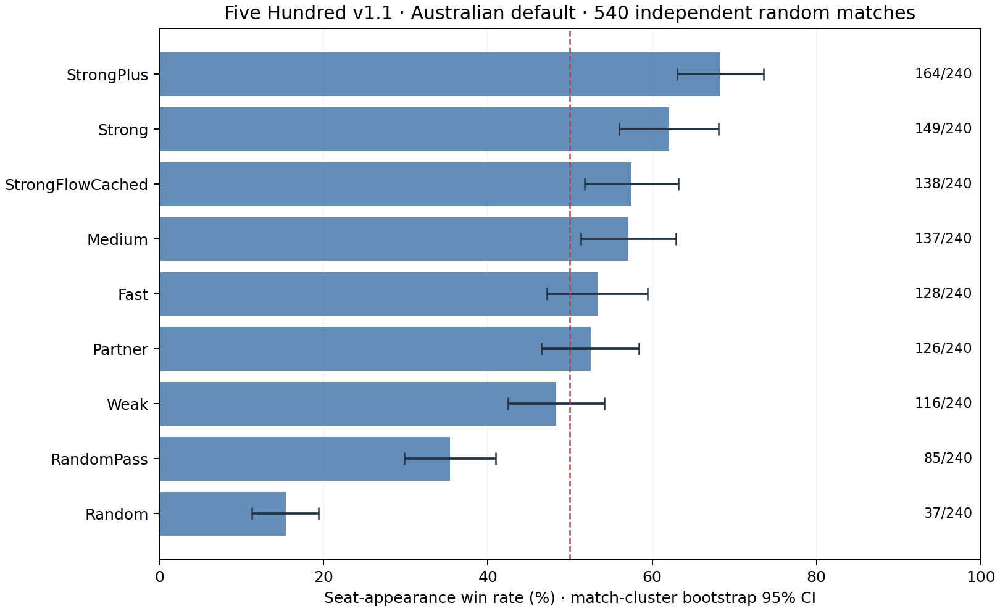

# v1.1 扩展合规检查与 540 场独立随机对战

日期：2026-11-10。先将 v1.1 更新以 `7005da4d` 同步至现有 GitHub 分支，再进行本轮独立验证。比赛期间没有修改引擎、九版 bot 的策略、搜索预算或默认规则。

## 结论与验证范围

新增 540 场全部正常结束、无异常或截断，并通过逐场回放及赛后独立回放。每版 240 个座位参赛人次、每个物理座位 60 次。完整回归 638/638 通过，其中本次新增 55 个测试行，另附 245 条场景审计记录、70,928 次计分断言（包含跨测试重复分配）。

主分析只使用新增 540 场；之前 180 场仅列为同规则的辅助合并样本，合计 720 场、每版 320 人次。旧规则下的 1,500 场及其他策略实验没有合并。

新增批次胜率点估计前三为StrongPlus 68.33%、Strong 62.08%、StrongFlowCached 57.50%。StrongFlowCached对StrongPlus的参赛胜率差为-10.83个百分点，未校正区间有后者占优迹象。StrongFlowCached对Partner的参赛胜率差为+5.00个百分点，区间跨零，尚不能确认差异。Strong对Medium的参赛胜率差为+5.00个百分点，区间跨零，尚不能确认差异。

此前180场中Flow为72.50%、Partner为66.25%；独立540场分别为57.50%和52.50%，先前的领先没有重复。期间没有改动策略，不能把批次点估计变化解释为代码退化；小样本、不同发牌和搭档/对手组合都会影响排序。当前不宜继续依据前180场把Flow列为胜率最优。StrongPlus虽在新批次点估计最高，但它对Strong的差异区间仍跨零。

## 特定场景合规

| 检查方向 | 范围及断言 |
| --- | --- |
| 计分 | 澳/美全部普通阶数与花色、四个定约座位、十墩在四席之间的全部286种分配；独立算式检查普通分值、250分保底与防守计分。另检查四种零墩、独战和无合约NT的个人/全队目标及正负分。包括真实三人合约中不可能出现的队友获墩分配，用于算子鲁棒性，不能当实战覆盖数。 |
| Joker | 5种领牌条件、3种跟牌模式×有无缺门×是否曾领该门×缺门强制×NT/零墩；低Joker与命名优先级；命名所有权与规则JSON往返。 |
| 竞叫与配置 | 澳/美Open的5种序位；Grand必须由已叫普通Misère的队友支持；强制庄家不允许Pass；Inkle不会成为正式合约。另以显式七阶资格门槛的美式自定义配置验证Inkle不冒充正式历史；拒绝互相矛盾的特殊合约人数、目标、取底流程和开关。 |
| 完整流程 | 5种合约×4个轮换庄位；验证参与人数、出牌张数、Grand顺次取底、独战交牌及额外弃牌；首墩结束后明牌及对手私有信息隔离。既有测试还检查开局明牌、Ace–no face申请和旧接口兼容。 |
| bot变体执行 | 9版×澳/美2预设×6场景=108副完整脚本局；包括命名Joker NT、低Joker明牌零墩、No Pickup、Grand、独战和全Pass无合约NT。脚本控制竞叫、可选提名及独战开关，弃牌/交牌/出牌由实际bot完成。另9版真实叫牌验证强制庄家。 |
| 非法与隔离 | 8种错误动作必须拒绝且不为失败副结算；修改玩家观察副本不能改变权威状态；篡改分数、赢墩或底牌的牌谱必须被回放拒绝。 |
| 缓存一致性 | NT/低Joker零墩/Grand/独战中逐行动对照缓存及未缓存续演的轨迹和效用；既有测试另覆盖普通有将。 |

扩展脚本的首轮运行出现了测试自身的预设假设错误：美式脚本误叫六阶NT，且把美式默认Misère误认为有先前七阶资格门槛。修正脚本为读取合法最低NT、在需要测试门槛时显式配置后重新完整运行。另按需求“前三人都Pass”的字面条件检查强制庄家；Inkle是信号叫牌，不能当作Pass。没有为通过测试而修改被测策略或引擎。

**组合语义需要注意：** 美式Inkle不是正式合约，也不是Pass。当前强制庄家只在前三人确实全Pass时触发；若前面只有Inkle而无正式叫牌，仍可能流局。若产品需要“凡无人正式叫牌就强制庄家”，应另行明确扩展该条件，不能与当前开关混称。

这些检查验证了指定场景下的规则执行与动作合法性，没有穷举所有JSON混搭组合，也不证明特殊合约的策略强度。引擎回放复用了权威规则代码；独立计分算式和明确边界断言补充其同源局限。

## 新增540场：主分析

每个物理座位分别打乱60份九版清单，允许同场重复类型；每席独立实例与随机种子，初庄轮换。540场的阵容、发牌种子、bot种子与源码指纹在首场前固定；独立于前180场，无按结果筛选或显著性提前停止，单场最多200副。

置信区间按整场比赛bootstrap 20,000次，保留队友共赢及同类型重复相关性。这是该随机搭档生态中的座位参赛胜率，并非固定搭档的成对直接对打。阵容虽逐席平衡，具体队友/对手组合仍有随机差异；初始竞叫相对位置也是随机平衡而非逐项完全相等，计数保存在summary。该区间是固定平衡随机阵容设计下的探索性近似。

| Bot | 胜/负（240人次） | 胜率 | 比赛聚类95%区间 |
| --- | ---: | ---: | --- |
| StrongPlus | 164/76 | 68.33% | 63.04～73.58% |
| Strong | 149/91 | 62.08% | 55.98～68.10% |
| StrongFlowCached | 138/102 | 57.50% | 51.74～63.20% |
| Medium | 137/103 | 57.08% | 51.33～62.92% |
| Fast | 128/112 | 53.33% | 47.17～59.44% |
| Partner | 126/114 | 52.50% | 46.52～58.41% |
| Weak | 116/124 | 48.33% | 42.47～54.20% |
| RandomPass | 85/155 | 35.42% | 29.80～40.94% |
| Random | 37/203 | 15.42% | 11.29～19.40% |



### 重点差异

下表为生态参赛胜率差，区间未做多重比较校正，仅作探索性比较；不能把差值解释为两版直接对打的胜率。

| 比较（前者−后者） | 差值 | 95%区间（百分点） |
| --- | ---: | --- |
| StrongFlowCached / StrongPlus | -10.83 pp | -19.11～-2.69 |
| StrongFlowCached / Partner | +5.00 pp | -3.94～+13.98 |
| StrongFlowCached / Strong | -4.58 pp | -13.51～+4.35 |
| Partner / Fast | -0.83 pp | -9.65～+8.03 |
| StrongPlus / Strong | +6.25 pp | -2.49～+15.02 |
| Strong / Medium | +5.00 pp | -3.83～+13.60 |

## 辅助：前180场与累计720场

此前180场已在开发后看过结果，不能当作新的独立验证；主结论应优先看新增540场。合并区间分别在180和540两个批次内重采样，保持预先固定的批次大小。

前批次生成后曾补充旧IPlayer未实现申请接口时的默认拒绝记录及配置版本保护，详见[原实验来源说明](../rules-v1-1-20261110/README.md#验证限制与后续)。默认Ace–no face关闭且九版均实现新接口，未改变该批默认对局决策；前180场已由最终引擎回放一致。本轮同时核验此前final-source-hashes与当前源码一致，不把生成/最终源码的差别隐去。

| Bot | 前180场（80人次） | 新540场（240人次） | 累计胜/参赛 | 累计胜率及95%区间 |
| --- | ---: | ---: | ---: | --- |
| Random | 10.00% | 15.42% | 45/320 | 14.06%（10.46～17.65%） |
| RandomPass | 38.75% | 35.42% | 116/320 | 36.25%（31.49～41.16%） |
| Weak | 40.00% | 48.33% | 148/320 | 46.25%（41.21～51.38%） |
| Medium | 55.00% | 57.08% | 181/320 | 56.56%（51.49～61.63%） |
| Fast | 57.50% | 53.33% | 174/320 | 54.37%（49.06～59.64%） |
| Strong | 50.00% | 62.08% | 189/320 | 59.06%（53.77～64.46%） |
| Partner | 66.25% | 52.50% | 179/320 | 55.94%（50.81～61.09%） |
| StrongPlus | 60.00% | 68.33% | 212/320 | 66.25%（61.61～70.82%） |
| StrongFlowCached | 72.50% | 57.50% | 196/320 | 61.25%（56.38～66.06%） |

## 定约行为与样本边界

新增样本共 4107 次发牌、1100 次重发，3007 副进入打牌。定约类型：Normal 2998副、OpenMisere 5副、Misere 4副。新特殊合约默认关闭。自然零墩数量有限，不能从普通随机对战推断其胜率。

| Bot | 定约副数 | 成约率 | 定约队平均得失分/副 | 平均普通叫牌阶数 |
| --- | ---: | ---: | ---: | ---: |
| Random | 397 | 9.57% | -303.58 | 8.56 |
| RandomPass | 0 | — | — | — |
| Weak | 59 | 100.00% | +148.47 | 6.49 |
| Medium | 223 | 83.41% | +127.17 | 7.04 |
| Fast | 213 | 78.87% | +105.96 | 7.08 |
| Strong | 716 | 65.78% | +35.98 | 6.78 |
| Partner | 230 | 79.57% | +109.35 | 6.97 |
| StrongPlus | 544 | 72.61% | +70.97 | 7.01 |
| StrongFlowCached | 625 | 64.48% | +35.57 | 6.94 |

RandomPass没有主动定约，是策略定义，不是遗漏。成约率和定约得失分受拿牌、抢标及竞叫选择影响，不能单独据此排名；定约队分数也不是扣除对手得分后的净胜分。

行为层面，Flow承担625副定约，成约率64.48%、定约队平均+35.57分；Plus承担544副，成约率72.61%、平均+70.97分。这提示后续优先对照竞叫取舍、弃牌候选和续演评估，但本轮没有模块消融或相同阵容/发牌的替换配对，不能直接认定差距来自某一模块，更不能归因于缓存本身。

### 搭档结构敏感性（描述性）

Random/RandomPass合称随机搭档，其余为其他搭档。子组并非成对控制，不能解释为某bot对弱队友的因果适应性；小样本百分比仅帮助检查阵容影响，详见summary中的同场对手座位对计数。

| Bot | 随机搭档胜/参赛 | 其他搭档胜/参赛 |
| --- | ---: | ---: |
| Random | 8/59（13.56%） | 29/181（16.02%） |
| RandomPass | 14/51（27.45%） | 71/189（37.57%） |
| Weak | 11/57（19.30%） | 105/183（57.38%） |
| Medium | 12/49（24.49%） | 125/191（65.45%） |
| Fast | 10/50（20.00%） | 118/190（62.11%） |
| Strong | 22/51（43.14%） | 127/189（67.20%） |
| Partner | 9/51（17.65%） | 117/189（61.90%） |
| StrongPlus | 18/54（33.33%） | 146/186（78.49%） |
| StrongFlowCached | 18/58（31.03%） | 120/182（65.93%） |

## 发现的入口集成缺口

旧 `FiveHundredArena run` 命令尚未统一到当前默认与bot工厂：不传--rules时仍创建旧Rules及旧bot；显式传v1.1 JSON后引擎变为1.1，但bot仍是旧RuleAwarePlayer。后者也未转发新的可选申请/独战/交牌接口，不能当作九版V11策略的等价入口。各做两场、每场限制一副的冒烟已确认实际版本及名称，记录见[入口审计](results/entrypoint-audit.json)，原始烟测牌谱另存cli-*-smoke.jsonl.gz。这4场故意在一副后截断，仅检查入口，不纳入540场胜率或无截断统计。

这是仍待统一的命令入口问题，不能用638项回归通过掩盖。本轮比赛通过显式RuleConfiguration.Load、Profiles.CreateForRules及Engine(rules)调用新版，不受影响；当前使用示例见[V11入口](../../FiveHundredLab/Bots/FiveHundred/V11/README.md)。本轮未修改入口或切换研究实现，后续应补上统一入口的集成测试。

## 成本与后续建议

Partner对Fast的参赛胜率差为−0.83个百分点，区间跨零。本轮没有证实其胜率优势或明显下滑；它面向真人搭档的价值仍应结合[此前体验探针](../rules-v1-1-20261110/README.md#体验检查)，不能仅按混合阵容胜率决定。

本轮四个互斥分片并行运行，合规及完整回归部分时间也在运行。自然决策调用次数、累计耗时和线程累计分配均保存在原始结果与summary，供定位阶段使用；不作为纯CPU基准或与此前毫秒数直接比较。没有在本轮重做耗时基准。此前v1.1同局面串行结果仍见[初次报告](../rules-v1-1-20261110/README.md#同局面串行成本)。

特殊合约的合法执行已获得更广覆盖；下一步强度评估应为Open Misère和新增特殊合约单独设计自然可达、固定发牌且交换席位的对照。对普通胜率差仍应结合区间，不按一次点估计宣布通用最强。工程热点仍是续演反复构造Medium及校验配置，可单独立项，在逐动作一致性验证后重新测成本。

## 数据、校验与复现

源码指纹与事前注册一致，冻结源码/模型 114 项校验通过。无赛后策略补丁、没有把失败局或超时局排除后重跑；本轮未出现这两类记录。540场每场均保留阵容、种子、全信息审计牌谱和统计。完整牌谱含隐藏牌，仅用于离线审计，不可作为玩家观察。

文件：[完整摘要](summary.json)、[胜率CSV](win-rates.csv)、[验证结果](results/validation.json)、[事前注册](results/registration.json)、[阵容/种子计划](results/plan.json)、[合规审计](results/compliance-audit.jsonl)、[回归测试明细](results/test-results.json)、[脚本开发及修正记录](results/test-development.json)、[独立回放](results/independent-replay.json)、[测试源码](../../TestBots/TestV11Compliance.cs)。每场为results/game-NNN.json与game-NNN.game.gz。

复现需.NET 8及Python NumPy/Matplotlib。从仓库根目录运行；已有结果先备份，prepare拒绝覆盖注册，审计JSONL必须使用不存在的新路径：

```sh
V11_COMPLIANCE_AUDIT=/tmp/v11-reproduced-audit.jsonl dotnet test TestBots -c Release --logger "trx;LogFileName=full-expanded.trx" --results-directory /tmp/v11-reproduced-tests
dotnet build experiments/v11-compliance-expanded-20261110 -c Release
dotnet experiments/v11-compliance-expanded-20261110/bin/Release/net8.0/Study.dll prepare
# run 0/1/2/3各启动一次；已保存完成记录可续跑，启动时核对源码指纹
dotnet experiments/v11-compliance-expanded-20261110/bin/Release/net8.0/Study.dll run 0
python3 experiments/v11-compliance-expanded-20261110/finalize.py /tmp/v11-reproduced-tests/full-expanded.trx /tmp/v11-reproduced-audit.jsonl
python3 experiments/v11-compliance-expanded-20261110/analyze.py
python3 experiments/v11-compliance-expanded-20261110/plot.py
```
